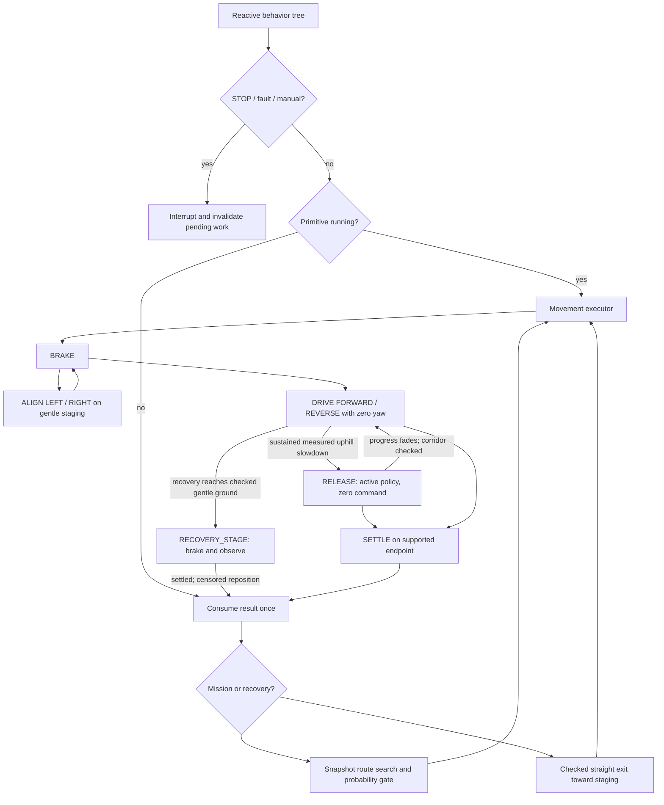

# Ascent behavior tree and movement state machine

## Control contract

The rocky-slope ascent profile permits 33° uphill travel. Cross-slope capability
is configured independently (25° by default). The planner
prefers lower grade/cross-slope exposure, and retains the 35° overall terrain
boundary. These are configured capability limits, not a calibrated probability
claim. Autonomous commands remain at or below 0.40 m/s. Baseline controllers
remain selectable, and policy weights, physics, and observations are unchanged.

V27 selects forward demand within the existing observed stopping envelope.
It tests the immutable nominal ceiling first, then a descending 0.025 m/s grid
down to 0.10 m/s. Every probe retains the measured-speed floor, actual-drift
check, terrain, freshness, passive-heading fan and exclusions. Probes do not
create motion outcomes or admission evidence. The chosen command is validated
and checked again before output; only actual output earns drive exposure.
No passing candidate retains the original censor and braking response. Reverse,
turning, braking and policy-active zero command remain unchanged. In particular,
RELEASE still requires its existing prospective nominal-forward envelope before
it can consider a powered correction. This finite speed grid is a simulator
characterization choice, not demonstrated braking or optimal traction control.

Optional trial-26/27 scheduling records are admitted through explicit reviewed
archived source hashes and labeled `legacy_executor_scheduling_witness`. They
can avoid repeating an initial route experiment but do not establish capability
under V27, update probabilities, or import mission no-go zones. Current route
geometry and eligibility are checked independently.

V28 restores checked departure from an occupied directional exclusion during
reverse-recovery stopping and braking. The complete failed-heading mask defines
distance to its boundary. Every crossed cell and diagonal bridge must have
non-increasing depth; an outside start, deeper travel, and re-entry remain
rejected. This grants no commanded forward retry or route-planning permission.
The reverse corridor, whole-patch exclusions, terrain, freshness and stopping
geometry still receive their ordinary checks. Braking uses recovery ownership,
not the sign of its damping command, to determine this context. Exclusions and
failure evidence remain intact. The main-ascent lateral boundary is unchanged.

The teleop adapter maps front/back to body X and left/right to yaw. Autonomous
movement uses those same primitive commands, with one primitive at a time.
There is no simultaneous commanded translation and turn. Above 15° measured
footprint terrain inclination, autonomous yaw is zero in every state. Re-entering
turning requires a supported staging footprint below 12°, low actual speed,
and a checked rotation envelope. Body lean is separate: turning pauses above
25° body tilt and can resume below 20°. These body limits are under simulator
characterization. Alignment occurs before steep entry.

V14 accepts a useful gentle-ground heading when its straight body-axis ray
reaches the inner 75% of the existing arrival disk. This avoids needless
corrections during forward or reverse travel without moving the destination.
All stopping, remaining-corridor, freshness, posture, speed and settling checks
remain binding. Active turn pulses keep their measured stopping contract to
avoid early-stop cycles under policy yaw unwind. The new arrival tolerance
does not change steep-entry or suspended-RELEASE admission.

V15 replaces the fallback for circular straight-motion obstacle overlap with a
continuous configured body sweep. Live forward/reverse, drift, braking and
RELEASE checks include the observed passive heading envelope and stopping-time
trend. Missing/discontinuous history cannot authorize that fallback. Ground
support, global planning and turning retain their circular contracts. The fixed
lateral corridor bound is unchanged. This revision has local tests and awaits
the outstanding independent review and successful physical characterization.
Its first full trial exercised the body-sweep fallback but did not complete
ascent; see the [trial evidence](validation/straight_geometry_revision.md).

## Ownership

- The reactive behavior tree prioritizes STOP, hard faults, manual intent,
  active movement (including observation/overspeed interruptions), recovery, and mission
  planning. It selects an action and explains why.
- One movement executor owns the exclusive motion state, direction latch,
  progress window, deadlines, and one completed/censored result per action.
The tree cannot replace a running action with a newly computed route.
- The ascent adapter owns checkpoint predictions/outcomes and terrain evidence.
  It reuses the existing costmap, full-crater prior and probability contracts.
  It does not execute the former ascent recovery or route-following state machine.
- The asynchronous planner owns a frozen map snapshot. Plans are generation
  tagged, rechecked at adoption, and cannot survive STOP, manual takeover, a new
  destination, a physical exclusion, or a materially changed start pose.

Search and adoption share a spatial observation contract: full geometry,
support and directional limits are checked across every segment; fresh local
observations are required within 2 m of the current pose. Compaction cannot
extend that freshness requirement to a distant prior-only segment. Execution
still requires fresh local footprint and stopping room. Adoption rejections
log the affected segment, reason and endpoint observation ages.

## Movement states

`IDLE -> BRAKE -> ALIGN_LEFT/ALIGN_RIGHT -> DRIVE_FORWARD/DRIVE_REVERSE -> SETTLE`

Protocol `staged-teleop-v24-measured-release` uses `DRIVE_FORWARD <-> RELEASE` for
forward uphill mission primitives. RELEASE sends exactly `(vx=0, yaw=0)`
through the active rocky-slope policy. It is distinct from braking and endpoint
settling. Reverse recovery and descent do not inherit this behavior.

Arrival, overshoot and lateral bounds are evaluated before the BRAKE, ALIGN,
DRIVE and RELEASE command branches: the policy can translate under any of these
inputs. Supported arrival enters SETTLE without further yaw, but only measured
settling completes a primitive. Alignment displacement outside the corridor is
a censored repositioning outcome, not proof of bad terrain. Complete-leg
predictions are frozen at first request admission, before any primitive output;
later route segments share that prediction and do not generate separate votes.

The characterization rule requires five cumulative seconds of deliberately
emitted forward command, directional uphill grade at least 10°, and a sustained
measured slowdown before trying RELEASE. A complete continuous two-second
current DRIVE window must show either committed-axis or terrain-gradient
progress below 0.10 m/s for one continuous second. Short low-progress history
resets on interruptions or invalid/missing samples; its dwell may accrue before
the five-second minimum. Temporary braking pauses preserve only cumulative
this exposure; braking time and positive damping commands never count. Actual
alignment, release entry and a new request reset it. Elapsed time belongs to
the previous emitted intent, including at BRAKE-to-DRIVE handoff. It retains
release while both committed-axis and terrain-gradient projected progress
are both at least 0.01 m/s. After a complete two-second measured response window,
five continuous seconds with either rate below 0.01 m/s resumes the same drive;
8 cm of backward displacement triggers an earlier
resume. Resume rechecks heading, the full remaining corridor, and the emitted
command. Heading correction still requires gentle staging. Productive release
can continue until arrival or the original action deadline.

DRIVE/RELEASE share progress history and action identity. After the two-second
measurement window detects low progress, the attempt expires at **12 seconds
of actually emitted DRIVE/RELEASE exposure or 24 seconds of wall time**, whichever
comes first. Held outputs are counted once at the next observation. BRAKE
damping, admission ticks and POSTURE_PAUSE consume wall time only. At least 10 cm
of net progress from the fixed episode anchor is needed to renew both allowances;
state transitions cannot renew them. Budget expiry without deliberate exposure
is censored, while independent physical failures remain failures. Gradient changes cannot
retroactively shorten an admitted allowance. All posture, speed, stale-scan,
backslide, displacement, arrival and STOP checks remain active. Prospective
forward room and the actual drift corridor are checked even at low speed;
zero desired velocity is never assumed to mean zero physical movement.

Overspeed braking suspends RELEASE intent. After measured settling, restoration
requires a fresh uphill fit, an advancing heading, the remaining corridor and
the release envelope; restoration emits zero on that same tick. Failed admission
is censored rather than replaced by unrequested forward drive. A separate
committed-axis observer retains progress and backslide history through DRIVE,
RELEASE and temporary BRAKE, including overspeed ticks. Repeated pauses cannot
renew either low-progress allowance. Only the short policy-response
window restarts. Arrival, STOP, a terminal outcome, actual alignment and a new
request clear suspended intent.

A rapid posture rise enters `POSTURE_PAUSE` instead of immediately declaring
a failed approach. An already executed forward uphill mission DRIVE/RELEASE
has a provisional entry exemption when a fresh fitted normal and same-tick
valid world attitude give a body-to-normal angle at most 20° and absolute body
tilt below 50°. The vector comparison checks quaternion validity and agreement
with measured yaw/uprightness. Missing or inconsistent data retains the original
rapid-change trigger. Reverse, recovery, braking, alignment and fresh entry do
not qualify. An independent 50° pause and the existing 60° hard fault remain.
An active pause cannot be cancelled by a favorable normal; its recovery dwell
and timeout retain their original rules and raw rapid-change signal.
These bounds are not a validated stability envelope: measured outward tilt
rates can exceed 100°/s. The exemption still requires every live motion guard.
Raw rapid-change signals, exemptions, relative angle and pause reasons are logged.

The provisional characterization state observes the active
policy at zero command for at most 1.5 s. Restoration requires tilt at or below
36.87° continuously for 0.20 s, plus the existing measured brake-settle condition
if overspeed interrupted the episode. Both observers consume every fresh sample.
If posture recovers before its 1.5 s deadline while braking remains unresolved,
BRAKE takes ownership and retains suspended RELEASE intent. This transfer emits
only the checked braking command, never a direct drive, yaw, or release command.
The original eight-second braking deadline survives posture interruptions;
repeated signals cannot renew it or the shared uphill attempt budget.
Hard tip, overspeed, stale observations, support and stopping-envelope protections
remain active. A stable/improving unresolved timeout is censored; continued
measured deterioration can be a physical failure. Map admissibility alone does
not establish a physical failure, including during SETTLE. RELEASE restoration
is rechecked; other intents return through BRAKE, never directly to stored yaw.

The prospective commanded approach retains the 33° uphill and 25° cross-slope
limits. Incidental drift uses a separate physical stopping envelope: fresh
observations, obstacle clearance, complete footprint support within 35°, and
directional exclusions. Instantaneous sideways sway is not evaluated as a new
commanded cross-slope approach. Checked departure from an occupied no-go patch
cannot deepen that exclusion or re-enter another patch. Rejections log the
category, world velocity and checked endpoint.

Leaving the endpoint radius while remaining physically supported is censored
repositioning, not success or terrain failure. Whole-leg physical outcomes are
separate from directional exclusions. Only commands actually held in DRIVE or
RELEASE supply traversal evidence, using the committed travel direction and
observed positions. Braking alone supplies none. Same-request braking retains
this evidence; realignment and new requests clear it. Exclusion requires the
last traversal observation to overlap the failed patch, and uses the result's
position/time. A planned reverse direction cannot close a patch without an
executed reverse attempt.

These timings and thresholds are experiment settings, not a calibrated traction
model. The two demonstrations support response-driven release but do not prove
an optimal pulse duration. See the [teleop release review](validation/teleop_release_revision.md).

`STOP`, manual takeover, and hard faults interrupt any state. Alignment is
allowed only at a gentle staging footprint. A drive primitive keeps yaw zero
and retains its direction until completion, a physical failure, new blocked
geometry, or an explicit interruption. Brake/settle use bounded longitudinal
velocity damping; they do not secretly turn toward an old path or checkpoint.

OBSERVE, PLAN and HOLD are behavior-tree phases, not additional command owners.
Entry alignment tolerance is 0.10 rad. Turning retains a 0.30 s measured stop
with actual yaw rate below 0.10 rad/s. An already aligned straight command can
also enter after a full 0.30 s with speed at most 0.25 m/s, opposing longitudinal
motion at most 0.10 m/s, and heading excursion at most 0.10 rad. This admits
small gait-induced yaw oscillations without treating them as a stationary turn.
Its measured heading envelope and yaw trend must leave room throughout the forecast stopping fan;
the remaining corridor and emitted-command checks still apply. Overspeed samples
cannot be omitted from the admission window, and sample gaps over 0.04 s prevent
admission. A blocked fan censors the request without a physical failure vote.
Suspended RELEASE also has a measured moving-restoration alternative. It uses
that same bounded 0.30 s motion window, requires recovered posture and a full,
continuous two-second displacement window with at least 0.02 m/s progress both
along the unchanged committed axis and uphill along the fresh terrain gradient.
The forecast stopping fan, remaining corridor and RELEASE envelopes must all
pass. Restoration emits exact zero and retains the request, axis, destination
and shared progress budget. Missing evidence keeps bounded braking active;
rejected geometry censors the approach. This alternative cannot admit a turn,
a new drive or a changed checkpoint. Each actual admission is logged.
An interrupted steep DRIVE has a separate continuation contract using the same
bounded motion window. It requires observed DRIVE execution in the current
request, matching direction and committed axis, recovered posture, a positive
heading projection and every live geometry check. BRAKE damping, RELEASE-only
history, actual realignment and previous requests cannot establish eligibility.
This can resume powered correction during a permitted small backslide; the
existing backslide threshold and shared progress budget still end the attempt.
Admission and the first actual resumed command are logged separately. Initial
drive entry, gentle-ground corrections and turning retain their heading rules.
Telemetry records both budget components and passive world-frame body quaternion,
angular velocity, and the contemporaneous observed terrain gradient/normal with
an explicit validity marker. These extra fields do not feed the controller or
policy. Absolute body tilt minus maximum footprint slope is not a measurement
of terrain-relative stability.
Left/right pulses use the teleop magnitude of
0.35 rad/s, last at most two seconds, and retain their sign until a zero-yaw
coasting phase. Pulses stop at signed measured heading error ≤0.02 rad, at
heading crossing, or at the two-second bound. No positive coast is assumed:
the policy can unwind yaw after release. Opposite pulses require settling first.
Every heading change, including cumulative small bends,
requires staging. Action deadlines use simulated time and terminal results are
consumed once. Repeated tree ticks never renew the action's deadline.

On gentle ground, alignment aims from the measured pose to the immutable
endpoint. Before alignment and drive, both that remaining corridor and the
actual commanded-heading corridor are checked. DRIVE latches the checked body
heading through steep entry; it never restores an obsolete start-to-end
bearing. Progress windows reset on realignment and use the new travel axis.
The original request retains its total displacement bounds and deadline.

Each route is decomposed into straight segments joined at supported staging
locations. The heading-aware search cannot offer a steep bend merely because
its adjacent cells are individually traversable. A steep start admits only
an already aligned straight direction; it never assumes the robot can pivot
there. Segment transitions stop and align on gentle terrain. The complete
checkpoint leg remains the probability/evidence unit.

Before checkpoint selection, each shelf-generated route can supply up to 16
checked connections to later staging vertices. These alternatives remove at
least 0.5 m of prefix detour and preserve the original terminal point and
complete/frontier status. The original route remains available. Every connection
requires gentle merge staging, valid starting heading, full geometry, directional
limits, exclusions and fresh near-field observations. Cost, whole-leg prediction
and retreat are recomputed for each alternative. Routes with the same checkpoint
prefix but different onward geometry remain distinct. This does not skip an
admitted checkpoint or any user mission destination. Telemetry separates the
complete candidate route from its next checkpoint leg and names rejected segments.

Route costs include a soft preference for ascending 10–30° away from the local
steepest-ascent direction. It competes with distance, roughness, clearance and
cross-slope costs; it never overrides the 33° uphill, 25° cross-slope or 35° ground
limits. The planner chooses and aligns to the approach before steep entry.
The recordings do not establish a universally best angle or left/right side.

Straight mission primitives can admit up to 1 m of lateral variation only when
all intermediate parallel bands pass the complete footprint/support checks.
Otherwise the existing 0.5 m bound applies. Per-command local checks remain
active throughout. Arrival uses one circular region, up to 0.3 m, consistently
for admission and settling; later legs are revalidated from the actual pose.

Actual response drives progress decisions. Slow positive progress is retained;
a sustained stall, backslide, large lateral deviation, or worsening posture
ends one physical attempt. Endpoint passage alone does not label success:
settling must remain close to the endpoint, on supported ground, with low speed
and low drift over a measured window.

Body-yaw variation alone is not physical failure. On steep terrain the same
zero-yaw drive continues while its actual corridor is checked, its command
still points along the committed travel direction, and measured progress,
posture, speed and displacement bounds hold. Progress stays projected onto
the committed axis; it does not rotate to conceal sideways motion. A newly
blocked corridor or opposing command heading censors the attempt. Heading
variation is logged once per action without creating a no-go vote.
After temporary braking on steep terrain, that same committed action may resume
only after fresh corridor and command checks and settled measured motion. It
retains the original progress axis and deadline instead of requesting hillside
alignment or redefining sideways motion as progress.

A useful displacement that overshoots the endpoint is explicitly `repositioned`,
with a censored endpoint outcome. Fresh, supported terrain at or below 12° permits
OBSERVE and replanning from the measured pose after settling. It creates neither
a success vote nor a physical-failure exclusion and does not automatically
request reverse recovery. Unsupported or steep endpoints retain the bounded
recovery contract.

## Recovery sequence

1. Brake, record the completed physical outcome once (or censor a planning
   rejection), retain the mission, and refresh observations.
2. On a steep patch, compare checked straight body-axis reverse/forward exits;
   prefer the lower supported staging location. Do not request a hillside turn.
3. Commit to the chosen bounded displacement. Do not alternate direction or
   interrupt it for an opportunistic new global plan. Successful displacement
   renews planning from the measured pose; it does not erase failure evidence.
4. Once a supported gentle staging footprint is reached, align for an
   independently selected approach. On gentle terrain a checked turn or
   straight reposition may create planning room.
5. Exhaustion means the finite recovery action/deadline budget has elapsed,
   or every checked primitive is blocked. Report the actual cause; never turn
   repeated control ticks into multiple physical failures.

Occupied exclusions allow monotonically outward checked departure and forbid
re-entry. Stale geometry or an unchecked stopping corridor cannot authorize
a new drive. Qualified mode applies the existing 80% normal / 60–80% fallback
with retreat thresholds to each complete leg and recovery approach.

## Verification

The independent control review covers tree priority, one command owner,
steep-turn prevention at planning and command layers, reverse heading semantics,
action cancellation, asynchronous plan adoption, evidence deduplication,
settling drift, exclusion escape, and observed versus commanded speed.

Unit/replay verification precedes seed-42 full-survey simulator characterization.
Failed trials remain recorded. Mission completion, calibrated reachability,
and the three consecutive qualification successes are separate claims.

The [independent review record](validation/ascent_behavior_tree_review.md)
documents the requested changes and re-review.

Recovery may enter `RECOVERY_STAGE` before its nominal retreat endpoint after actual drive and at least 0.4 m measured displacement. The complete circular rotation footprint must be freshly observed, at most 12°, and free of obstacles and directional exclusions; live stopping room and body tilt at most 20° are checked. This state only brakes or sends zero. A fixed six-second deadline and 0.5 m anchor bound survive interruptions, alongside the original movement bounds and recovery deadline. A contiguous 0.6 s measured settling dwell produces a censored reposition result, preserving the destination and failure evidence before normal route planning. This changes the recovery objective, not checkpoint success or reachability calibration.

V24 selects uphill RELEASE from measured powered response: five seconds of cumulative deliberate forward output is a minimum, not an automatic switch. A complete continuous two-second forward DRIVE window and one continuous second with either committed-axis or terrain-gradient progress below 0.10 m/s are also required. The short deficiency dwell can begin before the five-second minimum. Braking, posture pauses, alignment, RELEASE, a new request, invalid evidence, or a sample gap above 0.04 s clears the short response history. Outer request and attempt budgets remain unchanged. The threshold is a provisional characterization heuristic; it does not measure wheel slip or calibrated reachability.

## Explicit initial-corridor characterization

`--ascent_exploration_history RUN_DIRECTORY` enables a coverage experiment only in behavior-tree characterization with a labeled full survey. Up to eight map-derived gentle exterior portals add bounded complete-route alternatives. Existing costs remain unchanged; the selector chooses the lowest-cost eligible complete route from an untested first sustained-climb corridor. It rechecks complete geometry, turn staging, fresh near-field observations and geometric retreat. If no such candidate exists, it reports that result and holds. Once the first approach is adopted, normal bounded execution, recovery and replanning resume.

History is read-only scheduling metadata. It imports no probability, outcome count or mission exclusion. A corridor means a continuous metre above 15° along a straight approach; coarse coverage matching uses heading difference at most 10°, at least 1 m longitudinal overlap, and at most 1.2 m separation throughout that overlap. Different floor/rim detours and sub-cell shifts do not create new experiments. Source, policy, terrain, task, seed, spawn, capability and recorded material fields must match. Older logs lack body-mass/configuration hashes, which is disclosed rather than claimed as validated physics equivalence. Selection and adoption do not establish meaningful uphill execution or completion.

Omitting this option preserves normal cost ranking. Qualified mode rejects the option. All reported reachability remains unvalidated until independently calibrated.

V29 adds the opt-in `--ascent_launch_variant` comparison alongside exploration history. On initial selection only, each complete map-derived route can retain its prefix through the first supported gentle vertex after its first sustained climb, with a newly searched suffix to the exact destination. Original candidates remain. The original lowest-cost eligible route is the reference; a variant must belong to its existing coarse climb class, have strictly fewer compacted route bends through climb entry, and have strictly lower full-footprint inclination at launch. Initial body alignment is excluded from the bend count. Both measurements use the same map snapshot. Existing full-route, retreat, observation, probability and live-adoption checks remain binding, and existing cost ranks the eligible variants. No qualifying variant means an explicit diagnostic HOLD.

Logs label this `paired_launch_variant` / `same_climb_class` and retain the reference route, both complete climb prefixes, bend counts, launch support and approach headings. This is a launch-preparation experiment, not a new corridor or calibrated success prediction. Trial26/27 scheduling witnesses retain the exact V28 source/profile restrictions; no prior probability or exclusion is imported. The movement executor, cost weights, slope limits, policy, physics and exact destination are unchanged.

V30 is a separate characterization opt-in: `--ascent_uphill_speed_response`. At the first qualifying uphill surge above 0.45 m/s in an already executing forward mission primitive, it can select exact zero command through the existing policy-active `RELEASE` state. Entry requires a continuous two-second history of actual forward output, both committed-axis and terrain-gradient progress at least 0.02 m/s, positive current velocity in both projections, fresh valid observations and attitude, recovered body posture (`up_z >= 0.8`), and the existing stopping checks. The episode lasts at most 0.20 s. At or above 0.50 m/s, or on loss of required conditions, existing damping takes over. If speed falls to 0.45 m/s or lower, the ordinary checked RELEASE observer may continue. These are provisional experiment bounds; 0.50 m/s is an intervention threshold, not a guaranteed physical speed cap.

The episode is consumed only on admission and cannot repeat in the same primitive, even after braking, posture observation or alignment. Arrival, overshoot, lateral tracking, progress failure, deadlines, STOP and normal terrain protections still precede experimental output. Request, travel axis and outer low-progress exposure/wall budgets remain unchanged; no success or failure vote comes from the speed-response experiment itself. Without the option, the original all-direction overspeed handling and V29 profile remain active. The new source/profile still requires independent calibration before qualified autonomy.

The v26 scheduling ledger separately records a physically attempted entrance that ends in the exact execution-geometry censor. It requires at least 0.4 m projected forward advance, matching approach direction and band, proximity to the first sustained climb, an associated terminal movement, a verified actual command/target/pose CSV row, and archived guard-source compatibility. The 1 m pre-climb rule is coarse experiment membership, not competence. Floor-only movement, operator/stale interruptions and unexecuted plans cannot establish entrance coverage. Such a record has zero probability and exclusion votes; the sustained climb remains uncharacterized. Repeat `--ascent_exploration_history` to combine compatible experiment histories.

## Characterization experiment: fixed functional recovery region (V31)

The opt-in `--ascent_recovery_continuation` additionally requires `--ascent_uphill_speed_response` and its behavior-tree characterization constraints. It is not a qualification mode. At a productive reverse recovery's lateral boundary, the controller may certify one fixed map-derived staging region instead of treating the tracking departure alone as a terrain failure. It preserves the executor action, original deadline and travel axis, physical progress history, and recovery episode budget.

The candidate search checks a complete finite approach and full circular staging support. The fixed outer region is1m in radius, its inner entry core0.5m, and the independently checked approach half-width0.5m. Actual2s heading extrema, measured response direction and the existing stopping forecast all participate; these are geometric hypotheses, not guaranteed policy trajectories. Distant survey geometry supports planning. Every emitted command retains fresh stopping checks; the complete region must be fresh before inner-core staging, and drift must remain in the outer region. No slope yaw or speed increase is introduced.

The abandoned point prediction is censored once. A separate unvalidated region phase is logged before continuing reverse; its evidence key includes region/protocol semantics and cannot mix with point-target probability counts or the point-leg fitter. Execution attribution latches the measured reverse heading at the first actual phase output. The original travel axis remains the reference for physical progress. Common physical protections precede admission. Checked settling in the region produces censored REPOSITIONED, never point-target or mission success.

This version performs additional static geometry checks in the control loop. Its admission and steady-state latency must be measured; it is not the later lightweight optimization stage.

First arrival in the fresh inner core latches one observation time and anchor. Braking while posture settles stops asking for commanded locomotion progress; actual backslide still counts. Any later staging uses the same6s deadline and0.5m drift anchor, so boundary jitter cannot extend observation. Unresolved observation is censored, not a physical stall.

With this experiment enabled, raw nonfinite navigation inputs are rejected before mapping and kinematic arithmetic. The controller censors unfinished execution using explicitly identified last-valid observations and latches zero/HOLD until operator resume. A previously completed physical result keeps its original outcome/exclusion. First-observation failure does not invent a pose or outcome; STOP/manual takeover remain available.

## Passive event snapshots

`--ascent_event_snapshots` is optional for behavior-tree characterization. It retains at most four detached observed-map/controller snapshots and continues the mission. It records failed/censored primitive termination, first actual brake-envelope rejection per action, and first release-owned overspeed-to-brake transition. Ordinary DRIVE speed transitions do not consume slots. Snapshots do not authorize motion or modify exclusions, predictions, budgets, endpoints or control outputs.

Each `run.event-NN.npz` preserves pre-result/pre-exclusion geometry, last observed held traversal, command decision and underlying brake reason when available. Output dispatch is separate: returned, submitted to `env.step`, and completed. A step that was submitted but raised has unknown physical application; a stopped tick that never called `env.step` is explicitly unapplied. `run.snapshots.json` records files, write errors, duplicate/dropped counts, admitted bytes and copy latency, including on interrupted runs. The four-capture/64MiB cumulative admission budget bounds detached writer work; snapshots are compressed on the existing export worker. These are diagnostic snapshots, not restartable simulator states or additional independent attempts.

### RELEASE response memory characterization

`--ascent_release_memory` requires `--ascent_uphill_speed_response` and behavior-tree characterization; it cannot be combined with functional recovery continuation. At an actual RELEASE overspeed brake entry, a complete continuous four-second history of deliberately emitted zero commands can retain a nonpositive response on both the committed axis and current uphill gradient, measured over both two and four seconds. An observed earlier forward command in the same request and axis is also required. After braking, one independently guarded forward resumption may replace automatic RELEASE restoration. The feature does not change brake entry, speed limits, destinations, failure votes, or attempt budgets. It is an unvalidated response experiment, not a traction or success-probability estimator.

`--joint_log_dir NEW_DIRECTORY` adds optional physics-rate joint telemetry to characterization runs. Navigation startup settling is included. Join the pre-step navigation CSV, raw policy-action events, and post-step physics samples by control step. Raw policy actions precede wrapper clipping; physics samples contain processed joint targets, measured velocities and actuator-model effort estimates. Contact forces and wheel speeds alone do not measure slip. Logging overhead and partial-step status are saved separately in `run.joints.json`.
