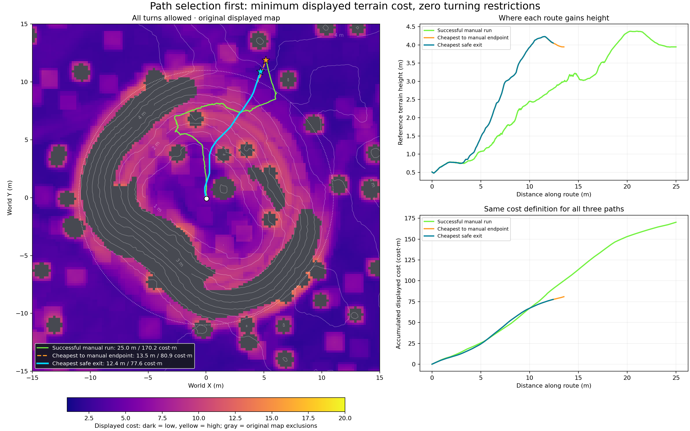
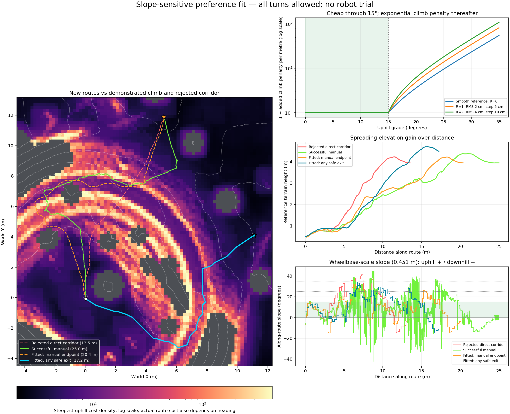
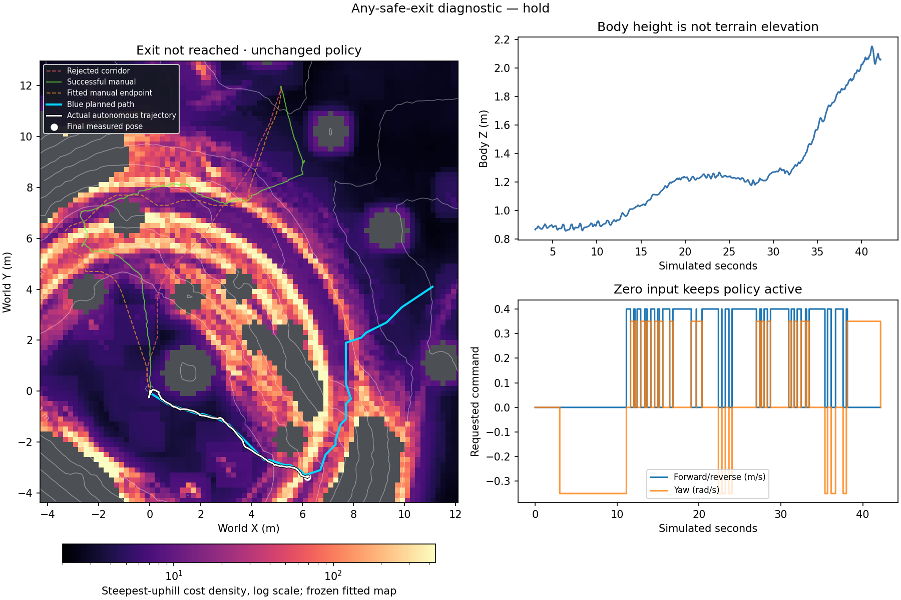
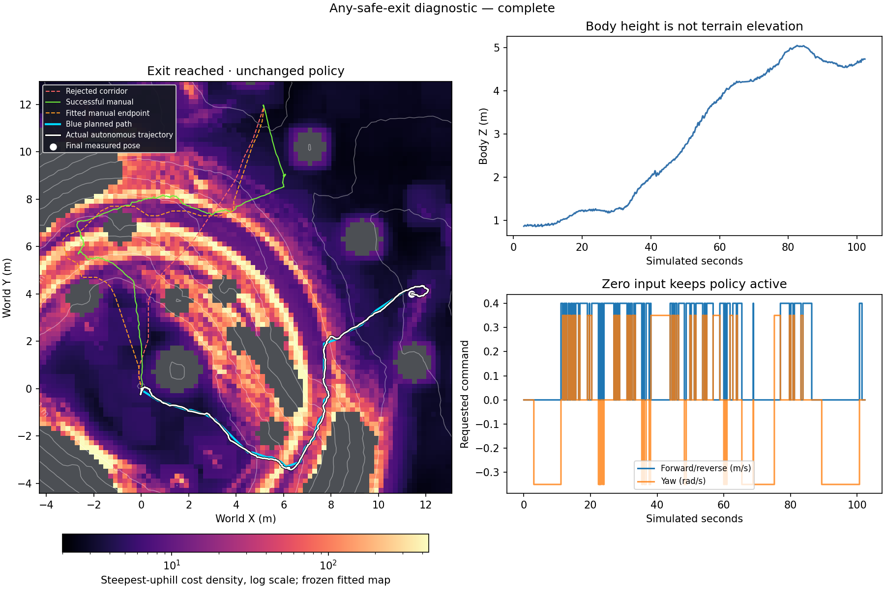

# Ascent-first navigation

**Latest result (24 October 2026):** the fitted blue path completed an autonomous
seed-42 simulation ascent in 102.30 s with motion vetoes disabled as requested.
See [completion evidence](#successful-autonomous-blue-path-ascent--24-october-2026)
and [current execution/plot contract](#user-override-unguarded-simulation-and-measured-recovery).

The repository includes the selected planning maps, route results, control logs,
plots and completion audits. Bulk joint/physics telemetry and the trained policy
checkpoint remain local. Archived absolute planning-input paths can resolve to
the corresponding file in a relocated checkout; provenance and checksums remain
unchanged. Recorded `run.sources/` snapshots identify the code used for each
simulation, before this path-portability addition. Packaging validation:
`PYTEST_DISABLE_PLUGIN_AUTOLOAD=1 python -m pytest -q tests` — 1,303 passed.

The `ascent` controller now defaults to a behavior tree and an exclusive movement
state machine. It is separate from the existing `checkpoint` baseline.
It uses the same rocky-slope checkpoint, observations, command injection, and
robot physics. Descent development and higher-speed tuning are gated on ascent
qualification; they are not enabled by this implementation.

## Full-crater development survey and visible ascent

Return ascent now starts with the whole crater's terrain information. For
development, `--simulator_survey` constructs an explicitly labeled terrain prior
from downward simulator-mesh raycasts before the mission. It does not move the
robot or supply a route. The planner chooses its own route from the resulting
elevation evidence and continuous costmap. This is a development information
condition, not validation of an onboard survey sensor.

Run this from `/home/susan/rexmi_rl` to open Isaac Sim with the overlays and
dashboard. Use a new log name for each run; existing evidence is never overwritten.

```bash
LD_PRELOAD=/usr/lib/x86_64-linux-gnu/libgcc_s.so.1 ./run.sh scripts/navigate.py \
  --task RexmiRl-Go2w-Crater-Bowl-RockySlope-Play-v0 \
  --checkpoint logs/rsl_rl/go2w_velocity_rocky_slope/2026-06-30_09-31-48/model_13994.pt \
  --mission ascent --ascent_architecture behavior_tree --ascent_mode characterize --simulator_survey \
  --perception_view --log_file outputs/ascent/my-visible-run.csv
```

The preset uses seed 42, floor spawn `(0, 0, 1.15)` facing +X, exterior target
`(13, 0)`, full map retention, and a 900 simulated-second limit. The initial
spawn physically settles; there is no teleport or automatic reset during the
mission. Explicit spawn overrides are for characterization, not qualification.
Only survey construction queries the simulator mesh. Planning consumes the
survey through the ordinary costmap; live LiDAR scans refresh local geometry.
The initial survey is saved as `my-visible-run.prior.npz`, with source, task,
seed, resolution, coverage and geometry checksum. The final `.map.npz` retains
subsequent sensor updates and can also be reloaded as a terrain prior.

To reuse the verified seed-42 development survey, replace `--simulator_survey`
with:

```bash
--terrain_prior outputs/ascent_full_survey/trial01/run.prior.npz
```

Loading recomputes costs for the current footprint. It imports geometry only:
each run starts with fresh attempt evidence, exclusions and local scan ages.
Saved geometry does not count as fresh LiDAR coverage. A task, seed, grid or
checksum mismatch is rejected. Full map retention is required in this mode.

Visible ascent enables the overlays by default; `--perception_view` makes that
choice explicit. `--no_perception_view` hides them without changing planning.
For headless trials add `--headless --no_dashboard`; no USD overlay is created.
Omitting both prior flags preserves the old local-only condition for comparison.

The terrain view has a continuous cost scale (1 to 12+), mint shelf boundaries,
and separately marked physical hazards and learned exclusions. Candidate
endpoints carry reachability labels in the dashboard. The control display and
viewport report mode, probability status, and command ceiling.
The Isaac Sim panel labels simulator-supplied geometry as development data.
Cyan points show live LiDAR; amber shows the complete selected mission route,
red the active checkpoint leg, and green the checkpoint. Independent checkboxes
toggle costs, points, routes and sampled rays; layer buttons switch between
terrain cost, slope, roughness and directional traversal evidence.
Candidate paths are drawn separately; A1/A2 labels connect them to the status
panel's evidence and rejection reasons. Validated estimates include local
success/failure counts and a conditional uncertainty interval.

The rocky-slope behavior-tree profile permits **33° uphill**, with a separately
configured 25° cross-slope limit, the 35° overall footprint boundary, and a
0.40 m/s command ceiling. There is no hidden one-degree uphill subtraction.
Lower grades and low cross-slope remain route preferences. These configured
limits do not substitute for physical validation or a calibrated predictor.

Use `--ascent_architecture legacy --max_uphill_deg 25` to reproduce the previous
ascent supervisor. The separate `checkpoint` baseline also retains its defaults.

## Terrain and execution

The baseline 2.2 m ground fit is complemented by a 1 m fit. A local plane needs
adequate samples and low residual error before it can identify a shelf.
The established broad ground-slope and obstacle classifiers retain authority
over motion; short rock facets do not create a second set of cliff exclusions.
A shelf must contain the footprint and clearance;
small attractive-looking flat cells alone do not qualify.

The bounded route search compares directional terrain costs and validates swept
support on every edge. Route selection considers direct, lower-grade contour,
and shelf-connected approaches. Its worker reads an independent geometry
snapshot. The control loop continues holding while it plans, rejects stale
plans after significant movement, and rechecks current geometry and probability
before accepting a result. STOP invalidates pending work.
Turn costs discourage alternating diagonal staircases. A shorter, checked
lookahead follows contour corners when the longer steering chord violates a
grade limit. Intermediate settling checkpoints use verified shelves; the
controller does not invent a stop partway up a continuous steep corridor.
Planned hillside bends and survey endpoints also check the follower's turning
reserve. A straight segment reaching a point does not establish that the robot
can turn there for its next leg.

The [behavior-tree control contract](ascent_behavior_tree.md) defines ownership,
transitions and review requirements. The tree selects an action; one movement
executor sends front/back/left/right through the same teleop adapter. Left and
right mean yaw, not lateral velocity. Autonomous drive and turn commands are
mutually exclusive.

Route search retains arrival heading as part of its state. Steep sections are
straight corridors; every bend requires supported gentle staging. Alignment is
performed before entering the climb. Turning is disabled above 15° footprint terrain
inclination and re-enabled only below 12° with settled motion. Body tilt is separately
limited to 25° during turns, with resumption below 20°. Full 0.35 rad/s teleop
yaw pulses are bounded to two seconds and separated by measured settling. The actual emitted
straight command and inertial stopping corridor are checked on every tick.

The movement FSM owns BRAKE, ALIGN_LEFT/RIGHT, DRIVE_FORWARD/REVERSE, RELEASE,
POSTURE_PAUSE and SETTLE.
For an uphill mission approach, the planner softly prefers a slight diagonal
entry where the complete corridor permits it. After deliberate forward exposure,
RELEASE sends zero desired velocity while keeping the rocky-slope policy active.
Measured uphill progress decides whether to continue release or resume the same
checked climb. Overspeed braking temporarily suspends that intent and restoration
requires fresh support and approach checks. It does not restart the traversal
stall budget. See the [two-demonstration analysis and simulator trials](validation/teleop_release_revision.md).
A primitive has a single-use ID, fixed direction, simulation-time deadline and
one terminal outcome. Slow positive motion continues; sustained stall, backslide,
continued posture deterioration or loss of a checked corridor ends the action.
A brief rapid tilt rise first gets a bounded zero-command posture observation;
recovery requires stable absolute tilt and any outstanding brake-settle checks.
Unavailable map support is a censored geometry rejection, not physical terrain
failure evidence. Steep
body-yaw variation alone does not end useful checked progress or request yaw
correction; actual corridor and travel-direction consistency remain required.
Arrival is confirmed only after supported, stable settling near the endpoint.

Recovery chooses a bounded straight reposition toward a useful staging area.
It keeps the selected direction during execution; asynchronous planning cannot
interrupt an active primitive. STOP and manual takeover censor the active attempt,
invalidate queued plans, and retain terrain and failure evidence. Manual release
does not resume autonomy. Brake/settle damp measured velocity longitudinally and
never pull toward a stale position or heading; unavailable stopping room produces
a zero desired velocity command and a recorded explanation.

Dashboard and Isaac Sim status include the active behavior-tree branch and
movement state. CSV/event logs preserve action IDs, transitions, inclination,
actual yaw rate, emitted commands, predictions and outcomes. Existing costmap,
LiDAR, route and checkpoint overlays remain available.

The [earlier recovery investigation](validation/ascent_recovery_status.md)
preserves the previous supervisor's failures; it is not validation of this new
execution protocol.

## Probability contract

The model predicts reaching **and settling on the next checkpoint along its
proposed approach**. It does not predict cell safety or complete-mission success.
An observation frontier is not silently treated as the final destination.

`characterize` is an explicit data-collection mode: geometry and command limits
still apply, but unsupported estimates are labelled **unvalidated**. There is
no fabricated default probability. `qualified` mode requires a model that
passed held-out checks and matches the actual policy SHA-256 and controller
source version. These checks also apply to recovery and regroup attempts. It rejects
routes outside the characterized feature range.

- At least 80%: normal attempt.
- 60–80%: fallback only if no normal candidate is available and a reverse
  retreat corridor passes geometry checks.
- Below 60% or unsupported: not probability-qualified.

Independent completed attempts update the local terrain prior as
`p = (4*p0 + successes) / (4 + successes + failures)`. The displayed 90% Beta
interval describes local evidence conditional on that prior, not uncertainty
for an untested terrain regime. Repeated control ticks never add votes.
Evidence keys include a quantized route trace, endpoints, direction, and signed
command. Different approaches around an obstacle do not share counts merely
because they arrive at the same checkpoint.

A confirmed physical failure blocks its local patch and approach, including
neighboring heading bins. Failure from a second distinct approach blocks the
patch in every direction. A pre-motion rejection or operator interruption is
censored. A route abandoned after meaningful travel is a failed reachability
outcome but does not by itself create a traction-based exclusion; mapped hazards
still block it. Exclusions persist for the mission and may
be exited through a checked corridor; they are never automatically loaded
into a new terrain instance.

## Fit and evaluate

```bash
/home/susan/miniconda3/envs/env_isaacsim/bin/python scripts/fit_reachability.py \
  --train outputs/ascent/train*.events.jsonl \
  --calibrate outputs/ascent/calibrate*.events.jsonl \
  --evaluate outputs/ascent/evaluate*.events.jsonl \
  --output outputs/ascent/model.json
```

The tool uses a regularized logistic model plus held-out sigmoid calibration.
Run IDs and completed attempts must be disjoint across splits. It evaluates
both initial predictions and chronological local evidence updates, reporting
Brier score, reliability bands, sample counts, and observed-rate intervals.
An unqualified artifact is still written with explicit failure reasons.
Unfinished, interrupted, incompatible-feature, and simulator-infrastructure
failure runs are excluded. Reliability uses only predictions within the
characterized feature range. Reports include complete-run bootstrap intervals
when multiple runs support a band; descriptive Wilson intervals alone do not
account for within-run correlation.

Initial evidence gates require three runs per split, at least 50 completed
training attempts, and at least 20 held-out attempts in each operational
probability band. Initial and online reliability errors must be at most ten
percentage points, and initial Brier score must improve on a constant training
base rate. These are development thresholds, not a hardware safety certificate.
All qualification samples must identify the same frozen policy and controller
source through provenance. Each operational band needs support from three
held-out runs. At least ten held-out attempts must have prior within-run
evidence to evaluate the online update; first-attempt predictions alone cannot
validate learning.
The recorded environment and capability profile must match too: a model fitted
with different grade limits or footprint dimensions cannot authorize the
current controller merely because its policy weights are the same.

## Qualification

```bash
LD_PRELOAD=/usr/lib/x86_64-linux-gnu/libgcc_s.so.1 \
/home/susan/miniconda3/envs/env_isaacsim/bin/python scripts/ascent_trials.py \
  --checkpoint logs/rsl_rl/go2w_velocity_rocky_slope/2026-06-30_09-31-48/model_13994.pt \
  --model outputs/ascent/model.json --mode qualified --runs 3 \
  --terrain-prior outputs/ascent_full_survey/trial01/run.prior.npz \
  --output outputs/ascent/qualification01
```

Each run starts with a fresh map initialized from the same full-crater geometry,
fresh local scan timestamps, and empty mission evidence. The launcher requires
three consecutive complete floor-to-exterior missions with a frozen model and
unchanged source and prior geometry, no intervention, no policy switches, no command above 0.40
m/s, and no tip. A failed run ends the qualification series. Characterization
completion can never pass this gate. `gate.json` records whether descent is
allowed; the launcher never starts descent itself.
The launcher defaults to behavior-tree ascent with 33-degree uphill and 25-degree cross-slope limits. Its `--max-uphill-deg`,
`--max-side-slope-deg`, and `--preferred-uphill-deg` flags must match the frozen
model's recorded capability profile; they never bypass model validation.
Qualified series require `--terrain-prior` or `--simulator-survey`. The model's
capability profile includes terrain information source and geometry identity:
the earlier local-only diagnostic model cannot authorize full-survey runs.

CSV, events, map snapshots, summaries, and provenance stay beside each run.
Provenance records checkpoint and source hashes; summaries distinguish initial
spawn transients from active-navigation speed and tilt. Preserve unsuccessful
and interrupted runs alongside successful ones.
New runs also save the exact navigation sources beside the logs. Use a fresh
log path for every run. The compact report includes outcomes, recovery counts,
backslide, tilt, commanded/actual speeds by terrain, and measured latencies.

The current development model at `outputs/ascent_v2/diagnostic_model.json` was
fitted to real attempts from trials 08/09, calibrated on trial 10, and evaluated
on trial 11. It is explicitly **unqualified**, including insufficient samples,
insufficient repeated-approach evidence, and mixed controller versions. It must
not authorize autonomous qualification. No ascent qualification series has
passed; descent, round trips, high-speed flat characterization, and stage-three
optimization remain unimplemented behind that gate.

Run CPU regression checks with:

```bash
/home/susan/miniconda3/envs/env_isaacsim/bin/python -m unittest discover -s tests -v
```

The [full-survey validation status](validation/ascent_full_survey_status.md)
records this information condition and the visible overlay check. The earlier
[local-only results](validation/ascent_v2_status.md) remain preserved as a
historical baseline. Unit tests and saved-map replay do not establish physical
ascent qualification.

## Initial route coverage experiment

For the reviewed route-diversity characterization, append `--ascent_exploration_history outputs/ascent_behavior_tree/trial26` to the visible launch above, using a fresh log name. The planner autonomously constructs routes and selects the cheapest eligible climbing corridor not covered by that compatible prior experiment. This is a declared experiment schedule, not a validated best-route or success-probability claim. No prior mission failures or exclusions are imported. The default launch retains existing cost ranking; this option is rejected in qualified mode.

To include the distinct censored entrance from trial 27 while retaining trial 26 sustained-climb coverage, repeat the option: `--ascent_exploration_history outputs/ascent_behavior_tree/trial26 --ascent_exploration_history outputs/ascent_behavior_tree/trial27`. The next entrance is chosen by the original cost ranking; no compass bearing or waypoint is supplied.

## Any safe exterior exit — 24 October 2026

The user selected **any safe exit first**, before a fixed exterior destination.
An opt-in remote ascent mode now implements that goal:
`--mission ascent --ascent_architecture remote --ascent_mode characterize --ascent_goal any_exit`
with the validated terrain prior and baseline additive objective. Fixed-goal
launches remain unchanged. This is experimental and has not completed ascent.

`exit_region.py` samples up to 64 exterior terminals on two crater-relative rings.
One heading-state graph searches them together with the existing additive terrain,
distance and turn costs. Single-endpoint height filtering and monotonic-height
preferences are absent in this mode. Existing turn, geometry, speed, STOP/manual
and policy contracts remain. The graph is bounded by 194 nodes, 37,442 directed
checks, 100,000 search transitions and a 180-second planning budget; a complete
checked search incumbent survives search exhaustion. Finite sampling is not a
proof of continuous-space infeasibility.

Success requires the measured full footprint outside the rim plus 0.25 m reserve,
observed hazard-free terrain at most 15 degrees beneath it, contiguous settling
for 0.6 seconds below 0.12 m/s and 0.12 rad/s, and the existing physical output
gate. Crossing radius 11 m alone is insufficient. Selected exits are separate
from the original placeholder waypoint and revalidated on asynchronous adoption.

The [offline result](../outputs/remote_autonomy/any-exit-20261024-v2/result.json)
selected a 12.799 m route to `(4.784, 11.548)` in 11.18 seconds. It passed static
checks, but retained a demanding climb: 31.622 degrees peak uphill and 3.926 m
above 25 degrees. It does not establish easier terrain or physical feasibility.
202 focused checks passed. Controls 8.4/10, practicality 8.2/10 and diagnosis
8.2/10 approved one unchanged-policy seed-42 trial; these are agent assessments.

The [physical diagnostic](../outputs/remote_autonomy/any-exit-physical-20261024-01/diagnostic_summary.json)
ended by requested SIGINT at 129.46 simulated seconds, without reaching an exit.
All 6,474 retained CSV rows have continuous 50 Hz timestamps. The first interruption
at 19.48 seconds was a local-minimum turn refusal, correctly censored rather than
marked a failed physical climb. Replanning repeatedly failed at its initial
heading state. Zero-input ascent and reverse retreat formed repeated cycles.
A new plan was accepted after the 110.02-second planning request, but the same
turn refusal recurred at 124.80 seconds. Maximum radius during the run was 5.273 m;
peak body-height gain from the 3-second settled reference was 1.358 m.
No physical climb failure was recorded. The robot was progressing when the
diagnostic stop arrived; this is not an autonomous terminal failure or proof
the corridor cannot be climbed. The signal interruption produced no normal
runner summary; raw logs, source snapshots, review and reconstructed summary
are preserved. No retry was launched.


Next bounded work: audit initial-heading/route-rejoining turn admission against
the archived live maps and measured motion, then review a combined translation
and yaw correction envelope. Do not change cost weights in response to this
planning refusal or claim the any-exit change solved physical ascent.

## Checked corrections and route rejoining — v29

The any-exit mode now admits heading corrections up to 0.35 rad without requiring
an exact slope minimum. The shared planner/runtime check covers the translated
body rectangle over the entire requested yaw interval plus measured yaw momentum.
It retains observed support, hazards, no-go footprints, 35-degree body terrain
and 32-degree cross-slope limits. Cross-slope is checked across all swept cells
and continuous headings. The drift forecast is provisional, not calibrated.

Corrections command zero translation and fixed-sign 0.35 rad/s yaw, rechecked
every tick, with a six-second maximum and three-second angular-progress timeout.
An inherited turn deadline cannot be extended. Full current-pose continuation
to the exterior must pass before correction. The existing 120-second/eight-action
recovery budget applies; another correction requires at least 0.5 m onward
response measured from turn completion. Drift during yaw cannot buy that credit.
STOP/manual ownership and the final physical output gate remain authoritative.

Rejoining proposes at most three points, 0.5/1/2 m beyond the projection onto the
active route leg, only within 1 m of that leg. Admission checks the complete
connector, joining turn, retained suffix and exterior endpoint. Rejoin, correction
and replanning do not renew stalled-progress timers without measured progress.
Large turns retain existing staging requirements; arbitrary turn locations are
not added to the finite planning graph.

280 regression checks passed. Controls 8.3/10, practicality 8.4/10 and diagnosis
8.3/10 approved one unchanged-policy seed-42 characterization run. These are
agent reviews, not engineering certification. The
[v29 offline result](../outputs/remote_autonomy/checked-turn-map-20261024-01/result.json)
preserved the archived map arrays and selected the same demanding 12.799 m route.
The first refusal pose admits a full rejoin using the nearest available map;
later stranded poses still fail near-field freshness checks. Neither result
establishes physical ascent success.

The [v29 physical diagnostic](../outputs/remote_autonomy/checked-turn-physical-20261024-01/diagnostic_summary.json)
was stopped by diagnosis-authorized SIGINT at 31.12 simulated seconds. All 1,557
CSV rows are continuous at 50 Hz; source hashes remained unchanged during the
run. No exit, checked rejoin or checked correction was completed. At 19.46 s,
all rejoin proposals were rejected and the direct continuation failed geometry;
forward recovery ended at 21.92 s, followed by repeated initial-state no-route
planning. Maximum radius was 4.678 m; body-height gain from the 3-second settled
reference was 0.762 m. No physical climb failure was recorded. This is an
operator-censored diagnostic, not a terminal autonomous failure or evidence
that the policy cannot climb the corridor.

The precise live rejection remains unresolved: this run did not archive the
19.46-second map or separate rejected-candidate reasons. The earlier nearest-map
audit cannot explain an exact live decision. After stopping, bounded diagnostics
were added: the first four failed rejoin attempts archive their exact map,
measured velocity/yaw rate, route and separate connector, joining-turn, suffix,
exterior and runtime-envelope checks under `run.planning-rejoins/`. Storage
failure is logged and cannot grant motion. Diagnostic probes use isolated
admission counters and event storage. 283 checks now pass, including exact
map preservation, archive bounds, capture failure and telemetry isolation. These diagnostics were
not exercised in another physics trial; no retry was launched. Resolve the
actual rejection before relaxing geometry, altering cost weights or claiming
physical ascent is solved.


## Path selection first: no turning restrictions

The user's next direction separates two problems: select a sensible path from
the cost map, then design execution and recovery. `scripts/plan_costmap_only.py`
implements an offline baseline with no turn vetoes, turn penalties, heading
state, minimum-slope staging, recovery rules or demonstrated intermediate
waypoints. It searches all known, unblocked cells of the unchanged manual-run
display map using Dijkstra and exact displayed-cost integration, `∫ C ds`.
The original gray exclusion mask and no-corner-cutting rule remain; no additional
turn-footprint or directional-grade constraint is imposed. Runtime execution
has not been changed or tested by this study.

The [result and complete route coordinates](../outputs/remote_autonomy/turn-free-costmap-20261024-01/result.json)
use a 0.2 m grid, 32 travel directions, 21,588 nodes, 637,191 directed edges and
9,031 supported gentle exterior candidates. The result is the global minimum
in that finite graph, not a claim of continuous-space optimality or physical
traversability. Start and comparison endpoint match the manual recording;
manual intermediate positions are used only for evaluation. Frozen map arrays
remain unchanged. Nine analytic/independent search and cost-integration checks
passed. No simulation was launched.

| Route | Length | Displayed cost | Peak uphill | Distance above 25° |
| --- | ---: | ---: | ---: | ---: |
| Cheapest safe exit, `(4.7, 10.9)` | 12.41 m | 77.63 cost·m | 31.73° | 2.90 m |
| Cheapest to manual endpoint | 13.51 m | 80.92 cost·m | 31.73° | 2.90 m |
| Recorded manual route, same endpoint | 25.00 m | 170.19 cost·m | 31.28° | 2.22 m |

Both computed routes take the northeast corridor. Removing turn restrictions
alone therefore does not select the successful western-ring strategy. The
displayed integral favors a shorter route with more distance above 25°; the
manual route has demonstrated execution and less such exposure. The manual
trace crosses about 0.03 m of the static exclusion mask, so that mask is not
perfectly consistent with demonstrated center motion either. Gradients in the
table describe geometric travel direction on the static map, not measured body
yaw, traction or success probability. The next discussion should assess the
northeast climb itself before adding executor/recovery complexity or modifying
terrain costs to prefer the ring.



## Exponential slope preference fit

The user identified the direct cyan corridor as impassable from their attempts,
and requested weights that favor the demonstrated western climb/ring strategy:
easy travel through 10–15°, increasing difficulty with each high-slope degree,
roughness interaction, and spreading elevation gain over distance. This is
recorded experience, not an inferred failure from a planner rejection.

`slope_cost.py` now supplies an offline directional density to `costmap_path.py`.
All turns remain unrestricted. With `F(a) = exp(max(a−15°,0)/6°)−1`, the fitted
per-metre cost is:

`displayed_cost + [F(uphill_grade) + F(terrain_inclination)] × (1 + 0.5 R) + (cross_slope/15°)^4`

`R = 0.5 × (detrended footprint RMS / 0.02 m + footprint step / 0.05 m)`.
Missing roughness uses an explicit non-smooth fallback. The added exponential
terms vanish through 15°; existing terrain/roughness costs remain. Overall
inclination remains costly even when a proposed path turns sideways. All edge
costs are positive; an exterior goal supplies the elevation requirement without
a negative height reward or a prescribed climb checkpoint.

A consequential correction was slope scale: the displayed gradient comes from
a **2.2 m plane fit**, which obscures short faces. Scoring now uses centered
height differences over the nominal **0.451 m wheelbase** on both map axes, with
the displayed gradient retained only where local interpolation support is
missing. These are static terrain estimates, not measured body pitch or wheel
traction. Raw cost-map arrays and masks remain unchanged.

The initial coarse-slope fits produced short switchbacks within the rejected
corridor and are retained in `slope-fit-20261024-01/02`. The wheelbase model's
54 candidates are retained in `slope-fit-20261024-03/candidates.jsonl`. A first
selection rule incorrectly demanded that every recorded manual adjustment be
globally cost-optimal; no candidate met that rule. The corrected selection fits
the demonstrated corridor geometry while retaining the raw executed trajectory's
score as a diagnostic. It does not replay the route or pass intermediate human
waypoints to the final search. This distinction matters: the actual trace
includes failed motion and corrections that a nominal route does not.

The [selected fit](../outputs/remote_autonomy/slope-fit-20261024-04/result.json)
and [parameter file](../outputs/remote_autonomy/slope-fit-20261024-04/parameters.json)
use 15° onset, 6° exponential scale, unit uphill and terrain weights, roughness
interaction 0.5 and unit cross-slope weight. Selection minimizes mean
bidirectional distance to the manual route among candidates whose generated
route costs less than the rejected route, using matched start/end. The selected
route is 0.505 m from the demonstration by that metric. Any-exit search is then
run independently using the same weights.

| Route | Length | Wheelbase-scale peak uphill | Distance above 35° | Fitted score |
| --- | ---: | ---: | ---: | ---: |
| Rejected direct corridor to manual endpoint | 13.51 m | 41.46° | 1.308 m | 472.20 |
| New western/ring route to manual endpoint | 20.36 m | 36.49° | 0.211 m | 294.49 |
| New any-exit route via southeast/east | 17.25 m | 34.53° | 0 m | 273.39 |
| Actual manual motion, including corrections | 25.00 m | 44.80° | 0.770 m | 955.56 |

Do not compare these local slope numbers with the previous table's 2.2 m plane
grades as though they were the same measurement. The manual execution's high
raw score remains visible; this is a same-crater **corridor preference fit**, not
a validated effort, energy or success-probability model. The new any-exit route
uses a different opening, and neither new route has been physically executed.
No executor/recovery change or simulation was made. Eighteen tests cover exact
directed costs, terminal connector orientation, exponential growth, roughness,
short-face detection and independent shortest-path checks. Source snapshots,
all candidate fits, route coordinates and component totals are retained.



### Reading the accepted route comparison

The user accepted this comparison and authorized execution of the **blue/cyan
any-exit path**, rather than the orange route constrained to the manual endpoint.
Colors in this figure have the following fixed meanings:

| Color | Route | What it demonstrates |
| --- | --- | --- |
| Blue/cyan (dark teal in profiles) | New minimum-cost any-exit path, southeast/east, endpoint `(11.1, 4.1)` | The fitted objective finds a cheaper opening when free to choose the exit |
| Orange | New path to the manual endpoint | The same objective independently reproduces the western climb/elevated-ring corridor |
| Green | Recorded successful manual motion | Actual execution, including corrections and failed movements |
| Red | Earlier direct northeast corridor | Rejected by the user after physical attempts; cheaper only under the old displayed-cost objective |

The left map shows steepest-uphill cost density on a logarithmic color scale,
with terrain-height contours. Actual route cost also depends on travel heading.
The three right panels show exponential cost versus slope, reference terrain
height versus distance, and signed along-route slope versus distance. The height
and slope panels share the cumulative horizontal-distance axis. Slope uses the
same 0.451 m wheelbase gradient as scoring and exact crossed-cell intervals,
without smoothing away brief steep faces. Positive is uphill, negative is
downhill; the shaded band is 0–15°, with reference lines at 15°, 25° and 35°.
Manual reversals and heading corrections can produce sharp signed slope changes;
these curves are terrain estimates along motion, not measured body pitch.

Blue climbs more gradually than the rejected red corridor while reaching a
different, higher opening. Its predicted peak uphill slope is 34.53°, versus
41.46° for red. Orange follows the manual corridor but avoids much of the
recorded corrective travel. The green trajectory's larger raw modeled cost
does not negate its demonstrated success. Fitting and evaluation share this
crater; the score is a terrain preference, not calibrated success probability.

### Execute the inspected blue path

`--ascent_path_result outputs/remote_autonomy/slope-fit-20261024-04/result.json`
selects `SavedPathController`, through the existing remote characterization
runner. It consumes only the planner's `any_exit` polyline, verifies the planning
map checksum and terrain identity, and records the result checksum. No human
intermediate positions or timed commands enter execution; no alternate route
is silently selected after refusal.

The follower projects measured position onto a bounded neighborhood of the
saved path and targets 0.35 m ahead. Heading error above 0.22 rad starts a
persistent ±0.35 rad/s turn, with measured completion and angular-progress
limits. There is no gentle-turn stage, local-minimum requirement or turn-cost
veto. Physical intended-motion, translated-yaw, measured-drift and stopping
sweeps remain, as do unknown terrain, obstacles, the existing 35° footprint
boundary, STOP/manual takeover, tilt, overspeed and the 900 s mission deadline.

Forward commands are capped at 0.40 m/s. A slow powered climb can release input
after five seconds; productive policy-active zero continues. An eight-second
release plateau permits one forward re-initiation per new progress increment.
Heading corrections remain available during climbing. Thirty-five seconds
without 0.1 m of new route progress, more than 1 m cross-track error, a failed
turn, or a physical refusal ends this diagnostic without replanning. The first
stop records its exact current map and pose. Completion requires the blue
endpoint within 0.4 m, a supported gentle exterior footprint, and 0.6 s measured
settling; crossing radius 11 m alone is insufficient.

The initial frozen-map audit passes all 26 straight segments and the endpoint.
Some exact corner rotations fail physical geometry. The feedback follower may
avoid those stationary corner poses; the simulation must establish whether the
selected corridor can actually be executed. One seed-42 trial is authorized,
using the unchanged rocky-slope policy and north-facing manual-baseline spawn;
no automatic retry or live code changes.

### Blue-path simulation result — 24 October 2026

The [single recorded run](../outputs/remote_autonomy/blue-path-physical-20261024-01/run.summary.json)
followed the selected corridor, but **did not reach the exit**. It ended normally
in HOLD at 42.18 simulated seconds: a proposed left turn's predicted physical
footprint exceeded the existing 35° terrain boundary. This is a geometric
command refusal, not an observed failed climb or proof the corridor is impassable.

| Observation | Result |
| --- | ---: |
| Progress along the 17.25 m planned route | 7.22 m, about 42% |
| Final XYZ | `(6.187, −3.377, 2.059)` m |
| Maximum cross-track error | 0.211 m |
| Peak body-height gain from settled 3 s reference | 1.285 m |
| Peak measured speed after settling | 0.558 m/s |
| Maximum commanded forward speed | 0.400 m/s |
| Recorded physical climb failures / manual intervention | 0 / none |
| Complete 50 Hz CSV rows | 2,110, continuous |
| Command-state durations | 21.50 s TURN; 17.68 s DRIVE; 3.00 s initial OBSERVE |

The robot made 27 turn entries and 26 returns to forward travel. No active-zero
climb-release state or forward re-initiation was exercised; their behavior
remains unvalidated by this run. The exact refusal pose, heading, velocity and
map were archived, alongside initial live-map geometry, the accepted result,
source snapshots, joint/physics telemetry and unchanged-policy provenance.
All runtime source hashes remained unchanged through completion.

The [exact refusal reconstruction](../outputs/remote_autonomy/blue-path-physical-20261024-01/diagnosis_after_trial.json)
isolates the **combined turn/drift forecast**, rather than stationary turning:

| Envelope evaluated at the refusal pose | Maximum footprint terrain slope | Outcome |
| --- | ---: | --- |
| Current occupied footprint | 30.49° | Pass |
| Stationary intended yaw sweep | 30.49° | Pass |
| Existing actual-motion stopping forecast, 0.212 m | 32.69° | Pass |
| New combined turn/drift forecast, 0.425 m | 35.57° | Refuse |

The longer forecast holds measured velocity `(0.276, −0.170)` m/s over 1.311 s,
carrying the predicted center southeast toward `(6.549, −3.600)`. Its full-body
envelope touches one known, fresh, non-hazard cell centered at `(7.1, −3.9)`,
about 0.894 m from the nearest planned centerline. That cell was already 35.54°
in the original map; the live estimate is 35.57°. Full forecast translation
without yaw also touches it, while stationary rotation through the complete
forecast yaw range still passes. These footprint values use the existing plane
gradient; they are distinct from the wheelbase-scale route-cost slopes.

The first execution question is therefore whether the provisional drift forecast
is accurate and how the follower should reduce drift before continuing its turn.
It does not establish that the stationary bend, the blue corridor or the policy's
climbing capability has failed. Preserve this result before changing cost
weights or relaxing a physical boundary. No additional trial was launched.

[Controls](../outputs/remote_autonomy/blue-path-physical-20261024-01/controls_review.md),
[practicality](../outputs/remote_autonomy/blue-path-physical-20261024-01/practicality_review.md)
and [diagnosis](../outputs/remote_autonomy/blue-path-physical-20261024-01/diagnosis_review.md)
each rated the bounded experiment 8.3/10; 160 focused tests passed before launch.
These are agent reviews and software checks, not physical qualification.
The run used 65% weekly account usage at preflight; no reset credit, retry,
alternate route or live code patch was used.



### User override: unguarded simulation and measured recovery

The user explicitly requested removal of **all motion guardrails in simulation**
after the forecast-only refusal. This supersedes the preceding trial's retained
physical-envelope, slope, tilt, speed and cross-track vetoes. The opt-in
`--ascent_unguarded --ascent_path_result .../result.json` selects
`ExperimentalPathController`; the previous guarded controller stays available
for reproducing its recorded experiment. No physical robot is controlled here.

The experimental tick sends policy commands without any footprint, clearance,
freshness, slope, yaw-staging, drift, stopping-envelope, body-tilt, measured-speed
or cross-track rejection. It retains operator STOP/manual ownership, handling
of nonfinite simulator observations and the finite 900-second experiment budget.
The existing policy, physics and teleop command values (±0.40 m/s, ±0.35 rad/s)
are unchanged. A simulator reset is recorded as an actual terminal outcome.
Endpoint success requires measured upright settling; the gentle-terrain map
predicate no longer blocks motion or endpoint arrival.

Recovery responds to measured route progress, cross-track distance and angular
response. Useful angular progress keeps a committed turn running. After an
eight-second response plateau, a zero-input release gets a forward push; stalled
forward travel gets a softly ranked heading adjustment. A five-second push
without useful progress selects a reverse of 0.5 m or four seconds, then another
heading/push attempt. Candidate headings use the fitted terrain preference and
local failed-push history, without terrain vetoes. Individual action timeouts
change the action rather than terminating the run. Productive zero-input travel
continues. Normal heading progress can renew the response timer; this is not
strictly an eight-second positional-stall detector.

Recovery gains, final projected progress and furthest route advance are logged
separately. STOP/manual, endpoint settling and simulation termination censor an
unfinished action; censored pushes do not teach failed-heading preferences.
No calibrated physical-climb-failure classifier is active, so that outcome field
is explicitly unavailable rather than reported as zero failures. Software
validation: 169 focused tests, including explicit absence of motion vetoes,
responsive/stalled yaw, push/reverse outcomes, operator ownership and completion.

**Plot contract:** keep the accepted frozen fitted cost field, `magma` palette,
logarithmic normalization (minimum 2, maximum the original valid-cell 99th
percentile), gray original mask and white height contours. The shared
`scripts/slope_cost_plot.py` renderer prevents the previous accidental switch to
the old linear `plasma` display costs. Blue/cyan is the planned any-exit path,
orange the manual-endpoint fit, green the manual trace and red the rejected
corridor. White with a black outline is measured autonomous motion. Runtime
map updates do not rescale or recolor this comparison background. The preceding
trial's figure has also been regenerated under this contract; raw telemetry is
unchanged.

### Successful autonomous blue-path ascent — 24 October 2026

The [unguarded run](../outputs/remote_autonomy/blue-path-unguarded-20261024-01/run.summary.json)
**completed the planned ascent and settled at the selected exterior endpoint at
102.30 simulated seconds**, without manual intervention, a reset or policy
change. This is a completed simulation ascent, not merely a connected map route.

| Observation | Result |
| --- | ---: |
| First radius ≥11 m crossing | 85.06 s |
| First entry into the endpoint's 0.4 m arrival disk | 86.36 s |
| Upright settled mission completion | 102.30 s |
| Final XYZ | `(11.403, 3.996, 4.734)` m |
| Final body-height gain from the settled 3 s reference | 3.869 m |
| Peak body-height gain | 4.183 m |
| Planned route progress | 17.247 / 17.247 m |
| Recorded XY travel after 3 s, sampled at 50 Hz | 21.010 m |
| Maximum cross-track error before first endpoint arrival | 0.211 m |
| Maximum cross-track error including endpoint overshoot | 1.002 m |
| Final speed / body-up component | 0.106 m/s / 0.969 |
| Feedback stall-recovery actions / manual interventions | 0 / 0 |
| Complete control records / physics samples | 5,116 / 20,460 |

The robot continued through the former 42.18 s predictive refusal and climbed
the selected eastern corridor. It overshot the endpoint, turned back and then
settled; this accounts for the larger final cross-track maximum and roughly
16 seconds between first arrival and completion. Approach speed/settling is a
useful later refinement; it did not prevent this ascent.

The policy was active during all commanded yaw and zero-input intervals.
There were no stall-triggered TURN/PUSH/REVERSE recovery sequences and no
productive-climb RELEASE state, so this run does **not** physically validate
those new recovery branches. It does establish that the chosen blue corridor
and its bends were executable in this seed-42 run without the rejected motion
vetoes. No new cost fit, human intermediate waypoint, policy change or retry was
needed. The exact accepted-result checksum and all runtime source hashes were
verified; telemetry has continuous 20 ms control timestamps, 5,115 completed
control steps (four physics steps each) and no partial final step.

[Run review](../outputs/remote_autonomy/blue-path-unguarded-20261024-01/review.json),
[independent completion audit](../outputs/remote_autonomy/blue-path-unguarded-20261024-01/after_trial_review.md),
[diagnostic summary](../outputs/remote_autonomy/blue-path-unguarded-20261024-01/diagnostic_summary.json)
and [comparison with the previous guarded run](../outputs/remote_autonomy/blue-path-unguarded-20261024-01/guard_ablation_comparison.json)
preserve the evidence. This is one demonstrated autonomous ascent on the fitted
crater; repeatability, different craters and stall recovery remain separate tests.


