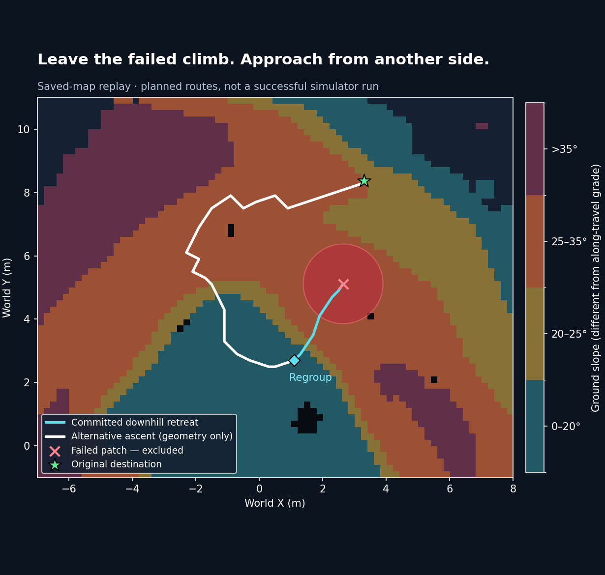

# Lower-grade ascent and committed downhill retreat

The reported failure was on roughly 30–31° terrain. The previous controller
recorded one physical stall, tried a short heading change, then repeatedly
offered the same hillside again. Direction-only exclusions and a 15-second
local recovery budget did not create a different approach.

## Route selection

| Quantity | Default |
| --- | --- |
| Preferred uphill grade along travel | 20° |
| Maximum autonomous uphill grade along travel | 25° |
| Maximum side slope across travel | 25° |
| Overall ground-slope exclusion | Above 35°, unchanged |

The planner searches the retained observed map with 32 directions. This allows
diagonal approaches between the old cardinal/45° choices. Every crossed cell,
corner and body footprint is checked; a longer diagonal cannot jump an obstacle
or unknown gap. Steering lookahead and commanded movement respect the same
grade limits, so the follower cannot cut straight uphill across a planned bend.

A diagonal reduces the slope along travel but increases side slope. Both are
checked. A 20° route is preferred when its length is within twice the shortest
valid candidate, or 6 m extra for a short route. Otherwise a route up to 25° may
be chosen. The controller does not silently relax these limits to retry 31°.
If no connected route exists, a survey endpoint must actually border unknown
terrain; merely reaching the foot of a known inaccessible wall is not progress.

Existing commands work. The optional settings are:

```text
--preferred_uphill_deg 20 --max_uphill_deg 25 --max_side_slope_deg 25
```

These are planning defaults, not measured limits of the trained robot. Keep
`--map_retention full` to compare return routes across the complete survey.

## After a failed climb

A confirmed uphill stall/slip, or repeated command rejection during ascent,
excludes the failed patch from normal routes immediately. The radius is the
greater of 1.2 m or 2.5 times the robot footprint radius (about 1.26 m for this
robot). This dark-red exclusion records an unsuccessful approach, not a claim
that the whole patch is a physical obstacle. Flat-ground slip learning retains
its previous directional-first, repeated-episode behavior.

Recovery selects an observed regroup point 2.5–8 m away, at least 0.5 m lower,
on terrain no steeper than the preferred grade. It compares up to four separated
candidates. Retreat routes may not contain more than 8° uphill travel and must
retain footprint, obstacle, unknown-ground and side-slope checks.

**The regroup point stays selected until reached.** Short checkpoints and local
replans remain parts of that retreat. The original mission destination stays
intact and is reconsidered only after reaching lower ground outside the excluded
patch. The failed patch remains excluded for the mission and is exported.

The robot can back away using the rocky-slope policy. After at least 0.6 m of
clearance and reaching terrain at or below 20°, it brakes and faces downhill
for forward travel. Measured speed above 0.45 m/s invokes braking feedback.
Braking damps current motion without steering back toward an old stop heading.
Predicted drift is checked against physical hazards; a momentary drift toward
a learned exclusion does not itself forbid an otherwise checked outward motion.
Commanded movement still cannot re-enter that exclusion.

The committed retreat has a 90-second limit, separate from the 15-second budget
for short local recovery. Operator STOP interrupts it immediately; Resume
refreshes observations. There is no policy switch or automatic reset.

## Evidence

The saved survey at 180 s provides a roughly 3 m downhill retreat from the
reported patch. From lower ground, replay finds a roughly 13 m approach around
the other side, with less than 25° uphill and side slope. Retreat planning uses
the snapshot's reconstructed freshness. The subsequent ascent comparison uses
stored geometry only; it is not authorization to drive on stale observations.



The first simulator trial committed to retreat but tipped during its reverse
descent. A second, with downhill braking and a forward-orientation transition,
held after repeated rejections. Those failures are retained in the report.
After correcting the stale braking heading, the latest trial completed two
downhill regroups at 38.2 s and 133.8 s. It stayed upright (minimum up-vector Z
0.808), used only rocky-slope at a 0.40 m/s ceiling, and required no intervention
or reset. It did **not** reach the destination: at 157.4 s it held after footprint
obstacle rejections and an unsuccessful braking attempt. Peak route error was
0.53 m. Route execution and obstacle proximity still need work; lowering the
ascent grade alone has not solved the complete climb.

All 187 regression checks pass, including 18 ascent/retreat checks. Trial
versions, failures and raw-log paths are in
[the validation report](validation/ascent_retreat_summary.json). Small event-log
and label updates after the last simulator run do not change motion behavior.
Map replay and controller tests do not establish three successful physical
crater traversals; navigation remains under validation.
