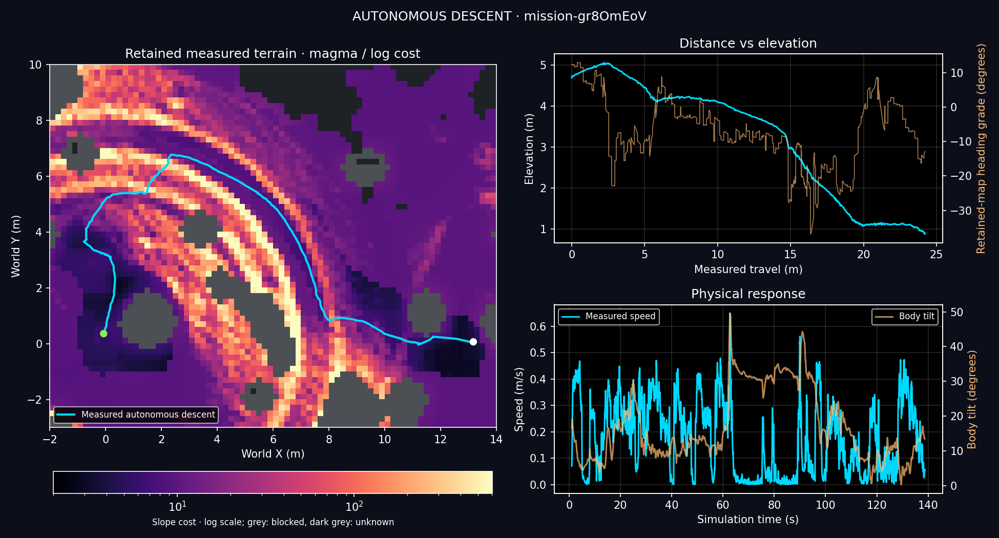

# Descent correction — 25 October 2026

**Unattended seed-42 descent completed in 138.74 simulated seconds.**
Ascent, its recovery controller, mission handoff, dashboard and cost-map colors
remain unchanged from checkpoint commit `dfc0ef7`.

Run the full mission in Isaac Sim from the repository root:

```bash
./crater_auto_nav.sh
```

## Retained changes

- Checkpoint measured-data reserve increases from 0.15 to **0.25 m**, beyond
  body radius, ordinary clearance and cell allowance. The existing additional
  0.02 m/degree above 15° remains. Future route cells retain 0.10 m reserve.
- Short inward contours are allowed: at least 0.05 m goal-distance gain.
  The 20° backout check uses travel grade. Exponential slope cost replaces the
  separate endpoint-angle cutoff; small outward bends toward an inward
  endpoint are allowed. Routes remain bounded to 2.5 m and 1.5× direct distance.
- The **occupied starting cell** may omit only the extra 0.10 m route reserve,
  provided its full body clearance and cell allowance are measured. All future
  cells and checkpoint margins stay unchanged. The exception cannot accumulate.
- DATA_WAIT uses the existing position hold. Drift beyond 0.20 m starts observed
  backout. Descent reverse keeps 0.4 → 0.7 → 1.0 m/s escalation and a 0.5 m
  measured-retreat target, with 18 s available instead of 6 s. Failed retreat
  ends in HOLD; it cannot release forward driving. Ascent keeps its original 6 s.

No new navigation states, viewpoint search, failed-route memory, whole-footprint
slope gates, precision recovery controller or steering rewrite were retained.

## Actual planner defect

A stopped run had **0.8246 m** measured clearance at its occupied cell. Body,
ordinary clearance and cell allowance required **0.7442 m**. The additional
0.10 m route buffer rejected the planner's starting cell even though a complete
observed center route existed. Allowing that already occupied, body-supported
cell recovered the route without opening any future unsupported cell.

[Saved derived geometry](crater_descent_completion_2026-10-25/supported_start.npz)
reproduces this failure in a regression test. It verifies route recovery,
exactly one permitted starting cell, removal of the exception when the robot
moves, and rejection of an unsupported body. The mission never loads this file.

## Physical validation

Current unattended run: `outputs/crater_loop/mission-gr8OmEoV`.
Command: `./crater_auto_nav.sh --headless --no_dashboard`.

| Measurement | Previous successful descent | Current unattended descent |
| --- | ---: | ---: |
| Center confirmed | 136.40 s | **138.74 s** |
| Center settled | 137.04 s | **139.52 s** |
| Horizontal travel after 1 s | 24.42 m | **24.20 m** |
| Reverse recoveries | 0 | **0** |
| Peak measured speed after 1 s | 0.514 m/s | 0.649 m/s |
| Minimum body up-vector Z | 0.718 | 0.648 |

No operator driving, loaded terrain prior, route replay, policy change or
respawn occurred. Unchanged ascent started from the retained live map. The trial
was deliberately interrupted at 228.78 s after demonstrating descent and
handoff; **this is not a completed round-trip qualification**.
[Compact evidence and source audit](crater_descent_completion_2026-10-25/supported_start_v9/audit.json)
confirm continuous 20 ms timestamps and matching runtime source hashes.
Bulk telemetry and exact runtime source snapshots remain local.

The known northern slope still causes repeated side-slope rechecks and reaches
about 50° body tilt. Completion does not establish smooth traversal or
multi-seed reliability. Those behaviors have not been hidden by further rules.



Cost and heading-grade curves use the retained measured map at center arrival,
not simulator ground truth. Elevation, speed and body tilt come from telemetry.
The cyan route is the measured trajectory.

The final STOP/RESUME regression also confirmed the center at **150.52 s**,
settled at **152.18 s**, and started unchanged ascent. It uses the same code
and a 200 s simulation budget. Its only operator inputs are STOP at 1.2 s and
RESUME at 10.66 s; it cannot count as an unattended mission. One reverse
completed 0.501 m in 2.58 s. The trial reproduces the earlier successful paused
descent with the starting-cell correction present. It ended normally at its
200 s test budget (`step_limit`, launcher exit 1), during ascent.
[STOP/RESUME evidence](crater_descent_completion_2026-10-25/supported_start_paused_v9/audit.json)
confirms matching runtime hashes and continuous timestamps. Peak active descent
speed was 0.700 m/s and minimum body up-vector Z was 0.586 (about 54° tilt).

**Tests:** 1,359 passed in 83.81 s. Ascent, handoff, shared controller, dashboard
and terrain display were compared with `dfc0ef7`; they are unchanged.

## Discarded trials

All are diagnostic runs, not reliability qualification. Exact code and raw
telemetry remain under each run's `run.sources/` and `run.provenance.json`.

| Revision | Run | Result |
| --- | --- | --- |
| Larger reserve v1 | `mission-KOJoClGP` | Reverse completed; HOLD at 60.92 s |
| Contour v2 | `mission-5SG3atod` | HOLD at 61.84 s; hard endpoint cutoff excluded contour |
| Contour v3 | `mission-qjfSM0Jd` | Reverse completed; 0.40 m reserve blocked next step |
| 0.25 m reserve, paused v4 | `mission-ZsTXtajY` | Center confirmed 150.52 s; settled 152.18 s; ascent started |
| Matching unattended v4 | `mission-593688cK` | HOLD at 40.8 s; supported starting cell rejected by extra buffer |
| Original selection v5 | `mission-Ax2oKc9J` | Reverse reached 1 m/s request; insufficient retreat after 18 s |
| Later rolling trigger v6 | `mission-loNj2XD6` | Reverse completed; HOLD at 66.1 s; trigger change reverted |
| 0.20 m reserve v7 | See local `minimal_uninterrupted_v7.run` | Same decisions as v5 due to grid discretization |
| Original planner v8 | `mission-sVS7gyXA` | HOLD at 40.0 s; active holding exposed reliance on accidental drift |

Ten earlier experimental trials also failed to demonstrate descent. Their
complex controller rewrite was retired at the user's direction and is saved
locally in `outputs/descent_completion_2026-10-25/retired_experiment/`.
