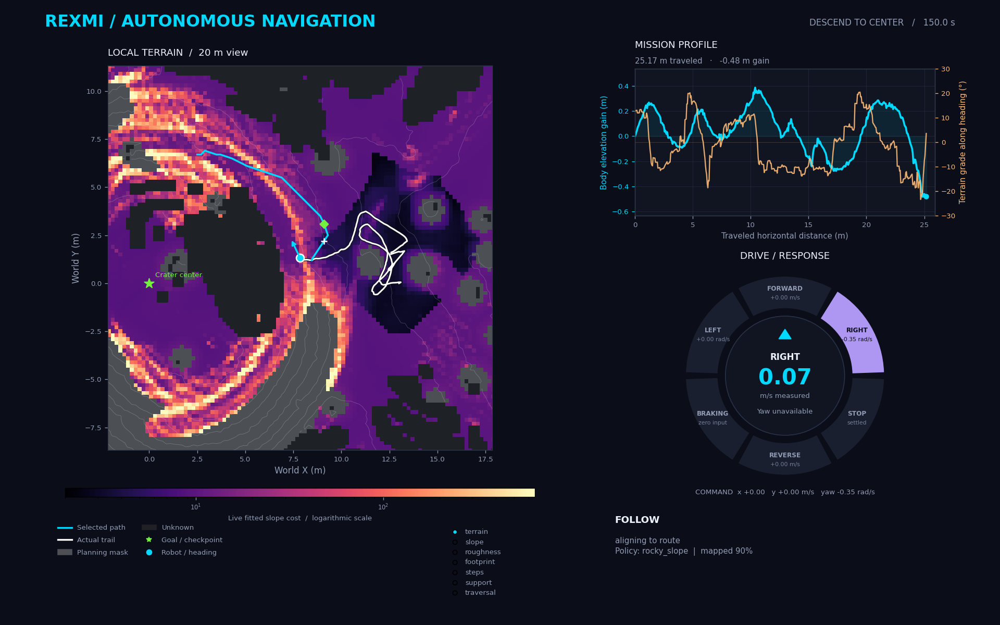

# Descent cost and observation reserve — 24 October 2026

Historical revision: the later [incremental descent update](crater_incremental_descent_2026-10-24.md)
replaces this version's large reserve and lateral viewpoint search. The results
and source hashes below remain evidence for this version.

The user observed a descent checkpoint too close to the available measurements:
a cliff became visible late, a leg caught, and recovery eventually pushed through.
The previous 158.12 s loop remains evidence for its original revision, not for
this more conservative planner.

## Changes

- Descent uses the same wheelbase-scale exponential slope model as ascent:
  15° knee, 6° exponential scale, terrain inclination, roughness interaction and
  cross-slope cost. Descent prices the **absolute signed travel grade**, so a
  steep downhill face is expensive too. The map uses the same magma/log display
  function; logarithms are not applied to the planning objective.
- Paths require 0.25 m of observed-data reserve beyond the body radius, ordinary
  clearance and cell-square allowance. Checkpoints require 0.75 m. This is a
  planning constraint, not a fresh predictive turning veto.
- The reserve is measured from actual sampled terrain coverage. Small sampling
  holes can be closed with a 3×3-cell operation; the plane-fit extrapolation
  beyond the sampled edge does not extend coverage. Map boundaries count as
  missing data. Every selected checkpoint logs its measured clearance.
- If inward progress is not visible, the robot can select a new supported rim
  viewpoint. It commits to that viewpoint across intermediate checkpoints and
  remembers visited positions. It does not shrink the reserve to force descent.
- Before forward travel, the follower aligns within 0.35 rad of the route.
  Newly observed obstacle overlap or stalled steering/drive invokes backout.
  A missing-data planning failure waits for scans and reports HOLD after 10 s
  without a viable supported checkpoint; it does not invoke blind forward pushing.
- Both loop descent and unguarded ascent share reverse recovery. Requests start
  at −0.4 m/s, then rise to −0.7 and −1.0 m/s after successive 2 s windows without
  0.1 m additional retreat. Each attempt ends at 0.5 m measured retreat or 6 s.
  Failed attempts retain a local escalation level; successful retreat resets it.
  Sideways drift does not count as retreat. These are requested velocities,
  not guaranteed body speeds. Forward cruise remains 0.4 m/s.
- Descent backout must lead into measured terrain without adding unknown or
  obstacle overlap; an existing overlap can be exited. STOP/manual ownership
  cancels the automatic recovery command.
- Ascent tracks route advance independently of yaw response. After 20 s without
  0.1 m route-score gain, repeated steering corrections or 5 s forward effort
  trigger reverse. Small successful turns can no longer conceal a persistent
  translation stall. A single productive initial turn is not cut short solely
  by this timer.

Implementation: `nav/descent_planning.py`, `nav/reverse_recovery.py`,
`nav/crater_loop.py`, the shared slope model and unguarded ascent executor.
The launcher remains `./crater_auto_nav.sh`.

## Validation

Regression tests cover exponential penalties for both grade signs, selection
of a longer gentler route, sampled-versus-extrapolated coverage, checkpoint data
reserves, lateral observation points and commitment, no blind forward fallback,
reverse escalation, measured retreat termination and STOP priority. The ascent
executor test verifies that −1.0 m/s reaches its emitted command unchanged.
The full suite passed **1,346 tests** in 83.50 s with
`PYTEST_DISABLE_PLUGIN_AUTOLOAD=1 python -m pytest -q tests` in `env_isaacsim`.
The [test output](crater_descent_observation_reserve_2026-10-24/pytest.txt) is retained.
A GUI smoke test, `./crater_auto_nav.sh --max_steps 200`, reached its expected 3.98 s
step limit with the dashboard and terrain overlay enabled, no dashboard render
exception, and launcher status 1 for the intentionally incomplete mission.
See the [GUI summary](crater_descent_observation_reserve_2026-10-24/gui_summary.json).
Shell syntax and `git diff --check` also passed.

## Simulation evidence

Final-source run: `outputs/crater_loop/mission-AHG7trWx`, seed 42, launched with
`./crater_auto_nav.sh --headless --no_dashboard`.

| Check | Measured result |
| --- | --- |
| Descent center confirmed | 271.70 s, XY `(−0.018, 0.343)` m |
| Settled center / frozen map | 272.34 s |
| Descent checkpoints | 40; minimum measured-data clearance 1.523 m |
| Required checkpoint clearance | 1.494 m including body, cell allowance and 0.75 m reserve; all passed |
| First descent reverse | 71.10–75.42 s; 0.501 m retreat; peak request 0.4 m/s |
| Second descent reverse | 85.40–90.32 s; 0.507 m retreat; peak request 0.7 m/s |
| Newly selected ascent | 19.519 m, fitted cost 302.610; exit `(10.9, 4.7)` m |
| Ascent stall detected | 336.72 s; repeated steering without route advance |
| Ascent reverse | 3.56 s, 0.505 m retreat; peak request 0.7 m/s |
| Subsequent forward response | Resumed route following at 341.62 s after measured progress |
| Last recorded state | 341.78 s, ASCEND_TO_EXTERIOR, XYZ `(0.176, 5.557, 1.899)` m |

The launcher session ended with status 143 (SIGTERM); no simulator process or
final mission summary remained. The cause was not established. **This revision
has not demonstrated a completed full loop.** The trace validates descent,
the map handoff and progress-triggered reverse recovery; it does not establish
that the new northern ascent route is executable to its endpoint. No operator
driving, policy switch or reset occurs in the retained trace.

The highest physically requested reverse speed was **0.7 m/s**. The 1.0 m/s
branch is verified by unit tests, including its emitted command, but was not
needed before this run ended. Do not interpret that branch as physically
qualified at 1.0 m/s. All 17,090 logged control rows have consecutive steps and
20 ms timestamps. Runtime source hashes and policy hash match the current
implementation; the frozen planning-map hash also matches.

Development trials exposed and fixed a route-event schema error, forward
corner cutting, lack of lateral observation viewpoints, viewpoint oscillation
across intermediate checkpoints, and ascent yaw response masking stalled
translation. An earlier trial also completed descent at 271.70 s but was
interrupted to fix the translation-stall detector. These trials are not counted
as additional completed missions; their bulk logs remain local.

## Retained evidence

- [Continuity, checkpoint-clearance and hash audit](crater_descent_observation_reserve_2026-10-24/audit.json),
  [runtime provenance](crater_descent_observation_reserve_2026-10-24/provenance.json),
  [run termination record](crater_descent_observation_reserve_2026-10-24/run_status.json).
- [Checkpoint, stage and recovery events](crater_descent_observation_reserve_2026-10-24/events.json),
  [10 Hz trace](crater_descent_observation_reserve_2026-10-24/trace_10hz.csv).
- [Exit plan](crater_descent_observation_reserve_2026-10-24/exit_plan.json),
  [route](crater_descent_observation_reserve_2026-10-24/exit_route.csv),
  [exact planning input](crater_descent_observation_reserve_2026-10-24/planning_map.npz).

The following dashboard is reconstructed at 150 s from recorded telemetry and
the [contemporaneous descent map](crater_descent_observation_reserve_2026-10-24/descent_display_map.npz),
using the actual dashboard renderer. It is not a screenshot of the headless
trial. The center remains partly unobserved; the robot selects supported
viewpoints around the northern rim instead of driving into that gap.

The [last recorded ascent dashboard](crater_descent_observation_reserve_2026-10-24/dashboard.png)
is also reconstructed. Its grade history uses the frozen center map and may
differ from live grades recorded during descent.
