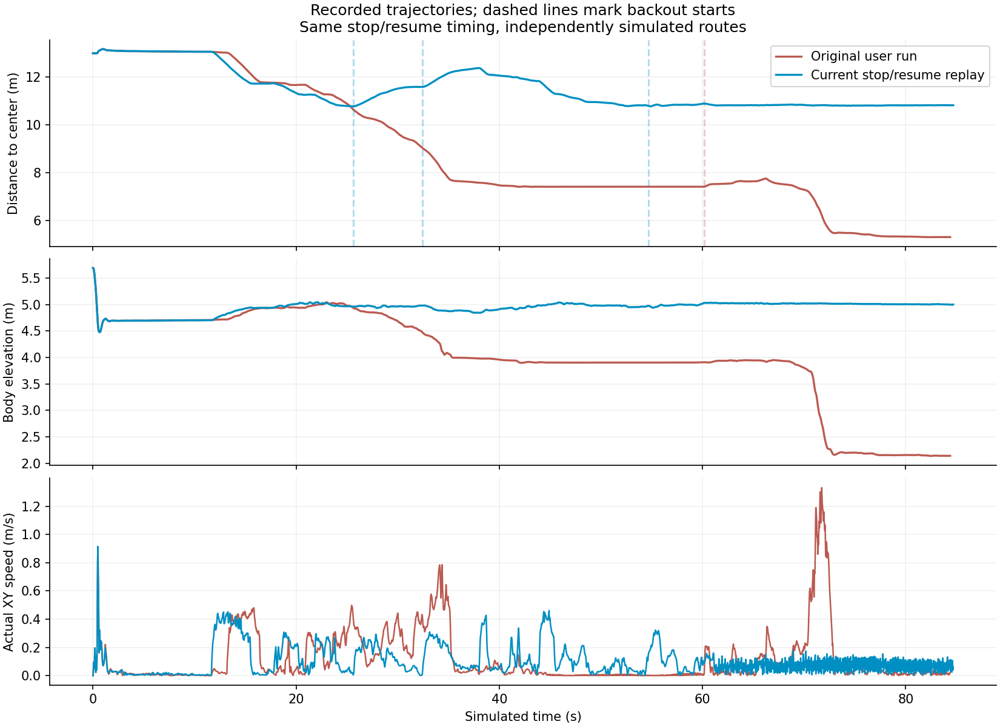

# Descent approach and recovery corrections — 24 October 2026

**Implemented, but not ready for successful autonomous descent.** Both final
seed-42 trials ended in HOLD before reaching the center. The changes correct
specific failures from the [user run](crater_edge_failure_2026-10-24.md), and four
retreats now demonstrate measured arrival plus stable holding. They also expose
remaining recovery oscillation and overly restrictive/missing frontier options.
The historical successful loop does not validate this revision.

The preceding state is committed as **`dfc0ef7`**, `Checkpoint continuous crater
mission and incremental descent experiments`. This correction remains a separate
uncommitted working-tree change. Bulk telemetry stays under `outputs/`.

## Implemented behavior

- Budget descent speed against measured spare ground: 0.4 s reaction distance,
  braking distance and 0.10 m reserve. Deceleration starts at 0.20 m/s² and uses
  worse measured stopping estimates when available. Actual overspeed triggers
  reverse braking; reducing the requested forward speed alone is insufficient.
  The normal cruise ceiling remains 0.40 m/s. This model is provisional, not a
  measured guarantee of traction on every slope.
- Use the exponential objective with the follower's directional limits inside
  search. Descent following and lookahead use the same touched-cell corridor
  check as planning, eliminating the separate sampled-corner approximation.
- Count OBSERVE → FOLLOW → SETTLE rejections occurring within one tick, including
  lookahead failures. Three nearby rejections within 15 s trigger recovery.
- Keep a fixed supported return point, preferring recently traversed ground.
  Reverse ceilings start at 0.4 m/s. After two seconds without 0.10 m of progress,
  requests escalate to 0.7 and 1.0 m/s while outside the arrival region.
  Inside that region, position/velocity feedback brakes and holds.
- Recovery success requires distance ≤0.20 m, actual speed <0.08 m/s, upright
  body and map support for 0.8 s. Six seconds is no longer an automatic release.
  Thirty seconds without success reports unresolved HOLD; it does not resume
  forward navigation. The return point remains owned by the hold feedback.
- Data waits actively resist drift; >0.12 m drift or >0.30 m/s motion starts
  backout. Invalidated paths/targets are cleared. Settling drift also triggers
  backout, including after a checkpoint arrival.
- While the center is not connected, require the **entire approach**, not just
  its last 0.6 m, to satisfy the 20° reversible-terrain screen in both local and
  wheelbase gradients. Newly disqualified current terrain triggers backout.
  This screen is experimental and may overconstrain useful contour approaches.
- Preserve ascent execution, magma/log display colors, dashboard layout and
  `./crater_auto_nav.sh`. Add timed STOP/RESUME replay for regression testing; the replay
  records intervention and never counts as an uninterrupted mission.

## Physical evidence

Final source fingerprints match both runs exactly. No source changed during
these trials. They use the same policy, seed and spawn as the user incident;
only the pause timing is replayed, not poses, sensing or the route.

| Measurement | STOP 1.20 s / RESUME 10.66 s | Uninterrupted |
| --- | ---: | ---: |
| Run | `mission-Mp5z5Dwq` | `mission-dC1ymFoH` |
| Final result | HOLD, 84.68 s | HOLD, 75.28 s |
| Closest distance to center | 10.778 m | 9.342 m |
| Peak active XY speed, after 1 s | 0.461 m/s | 0.444 m/s |
| Reverse attempts / successful stable returns | 3 / 2 | 2 / 2 |
| Successful retreat distances along initial reverse axis | 0.799, 0.745 m | 0.776, 0.657 m |
| Successful retreat durations | 5.74, 4.56 s | 6.04, 6.62 s |
| Final issue | Arrival oscillation / recovery timeout | No acceptable observed checkpoint after rescanning |

The uninterrupted run's two successful retreats exceeded the old six-second
release boundary in one case and the nominal boundary in the other; both waited
for the stable-arrival evidence. The paused run's final attempt moved 0.617 m
but oscillated around the 0.20 m target tolerance (final error 0.204 m), so it
correctly did not claim recovery success. That oscillation is still a defect.

Neither final trace reproduces the original run's large late downhill slide,
but both stop much earlier in mission progress. **This is not successful descent
or a reliability result.** Headless execution ends at terminal HOLD; continued
physical holding after that point is not tested. Ascent and the GUI were not
revalidated because neither final trial reached the center.

The figure compares independently simulated trajectories. Body elevation includes
spawn settling and posture; it is not a terrain-elevation profile. Lower radial
distance in the old run includes uncontrolled downhill displacement.

## Development trials and checks

- `mission-P4z1d3yh`: initial response, HOLD at 79.68 s. A temporary blanket
  0.20 m/s cap slowed progress; recovery increased its ceiling without increasing
  the actual near-target request. The cap was removed and actual escalation added.
- `mission-sCi3vpRM`: immediate backout at 38.70 s, following DATA_WAIT at 38.68 s;
  actual −1 m/s could not recover the steep approach. HOLD at 68.70 s. This exposed
  the inadequacy of checking only the endpoint's retreat segment.
- `mission-jNAbxxGX`: whole-approach screen, HOLD at 35.66 s. Already-disqualified
  terrain waited for scans; the final change routes this case to backout.
- Final full CPU suite: **1,365 passed in 83.88 s**. Tests cover immediate rejection
  counting, retained recovery after six seconds, stable arrival, drift, actual
  escalation, operator override, stopping budgets, planner/follower admission,
  steep approaches to gentle endpoints and timed replay validation.
- `git diff --check` passed. No final runtime changes after the two final trials.

## Remaining work

1. Remove recovery chatter at the arrival boundary. The discontinuity between
   escalated reverse outside 0.20 m and proportional hold inside it can repeatedly
   break the stable dwell. Test a distinct braking/holding capture region or
   measured holding compensation before another full mission trial.
2. Diagnose the frontier screen with decision-time map snapshots. The current
   isotropic 20° screen can reject a contour with manageable directional return
   grade; do not infer that every rejected route is physically impossible.
3. Prevent repeating a recently unsuccessful approach without new useful evidence.
   This must preserve short goalward progress rather than reinstating rim tours.
4. Repeat both pause and uninterrupted cases to the center and through ascent.
   Passing unit tests or stopping before the cliff does not close the loop.

Evidence: [numeric review](crater_descent_response_2026-10-24/review.json),
[paused summary](crater_descent_response_2026-10-24/paused_final/summary.json),
[uninterrupted summary](crater_descent_response_2026-10-24/uninterrupted_final/summary.json),
[collection script](crater_descent_response_2026-10-24/collect_review.py),
[test output](crater_descent_response_2026-10-24/pytest.txt).
Each final evidence directory also contains events, source provenance and a
10 Hz trace. Raw 50 Hz logs, maps and runtime snapshots remain local.
