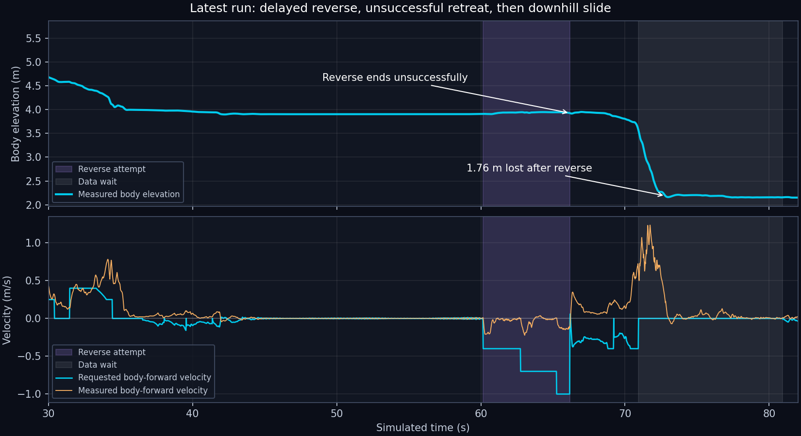

# Latest user-run edge failure — 24 October 2026

Follow-up: [implemented corrections and physical trials](crater_descent_response_2026-10-24.md).
The correction improves retreat ownership but has not completed descent.

**Confirmed failure in `mission-pdI7CPgR`.** Its runtime source hashes match the
current code. The prior 136.4 s descent established one successful trajectory;
this run exposes edge-approach and recovery defects that invalidate any broader
reliability claim. This is a diagnostic review, with no controller changes.

## Recorded sequence

| Simulated time | Evidence |
| --- | --- |
| 31.48 s | Selected `(7.7, 1.1)` from `(9.335, 0.578)`. Logged measured-data clearance: 1.0 m; additional reserve: 0.15 m. |
| 31.48–34.50 s | Actual horizontal speed peaked at **0.786 m/s** despite requests no greater than 0.4 m/s. Body elevation fell 0.496 m. |
| 34.50–36.50 s | `DATA_WAIT` issued zero forward/yaw commands. The robot nevertheless moved **0.406 m** horizontally. |
| 36.52–60.16 s | Repeatedly planned and rejected routes for side slope above the follower's 25° limit. Reverse began **23.64 s** after the first rejection. |
| 60.16–66.18 s | Reverse requested −0.4, then −0.7 at 62.76 s and −1.0 m/s at 65.26 s. Measured retreat was only **0.339 m**. The event explicitly records `success: false`. |
| 66.18 s | The controller nevertheless left BACKOUT for SETTLE and returned zero input. |
| 66.18–70.92 s | Hold commands were mostly reverse, capped at 0.4 m/s. The robot lost its retreat, displaced 0.89 m horizontally and dropped 0.34 m. A moving-scan fallback briefly reopened route following. |
| About 70.94–73 s | Entered DATA_WAIT again. Zero requested motion did not arrest the slide; actual horizontal speed reached 1.33 m/s. |
| 73 s | Relative to the end of reverse, displacement was **2.57 m horizontally** and **1.76 m downward**. |
| 80.94 s onward | HOLD: insufficient observed checkpoint clearance after rescanning. Last recorded row: 84.38 s. |

The run includes an early operator stop/resume near 1.2/10.7 s. That changes
the observations and later trajectory relative to the uninterrupted run, but
does not excuse these control defects. Both use seed 42 and the same policy.

## Causal findings

1. **Geometric clearance was treated as sufficient evidence of recoverability.**
   The frontier check requires an observed, gentle nominal reverse segment,
   but the 0.15 m additional reserve is independent of actual approach speed,
   demonstrated stopping distance and slip. The robot was moving faster than
   requested, and waiting did not keep it at the selected stopping point.
   The only retained map snapshot is from 60 s, so the precise cliff geometry
   at the 31.48 s decision cannot be reconstructed from that snapshot.

2. **Planner and follower disagree, and the rejection detector misses the loop.**
   The cost-map search uses body support and exponential costs without the
   follower's 25° directional admission check. The follower repeatedly rejects
   the resulting route. `CheckpointController.tick` records `was_following`
   before calling `_tick`; an OBSERVE → FOLLOW → SETTLE transition within that
   call bypasses rejection counting. A direct reproduction with three such
   transitions yields zero recorded rejections and zero recovery calls. The
   slower general replan timeout eventually starts reverse instead.

3. **Unsuccessful reverse and successful reverse share the same exit.**
   `ReverseRecovery` correctly reports failure at the six-second limit, but
   `DescentController._tick` ignores `result['success']` when choosing SETTLE.
   The robot had not reached even the 0.5 m retreat target. It used the requested
   1.0 m/s only during the final 0.92 s. Afterward the ordinary hold controller
   could not preserve the recovered position. This was not a completed retreat.

4. **DATA_WAIT assumes zero request means no movement.**
   It returns `Motion()` while waiting for map updates and does not use the
   position-hold controller or own a measured-drift recovery. The second wait
   occurred during an active downhill slide. Old path/checkpoint information
   also remains visible after a missing-data planning failure.

There is **no evidence of lost localization**. The runner uses `SimLocalizer`,
which reads simulator ground-truth pose. The recorded trajectory is continuous
(maximum horizontal step: 0.0266 m per 20 ms). After displacement, planning
cannot connect the new body position to its supported map; this explains the
apparent confusion. The logs do not identify individual foot contacts.

## Required correction

- Keep short goalward advances, but make edge approach speed and stand-off
  depend on measured stopping/holding response. Reject continued approach when
  actual motion exceeds the recoverable stopping envelope. A smaller nominal
  checkpoint reserve alone does not provide that envelope.
- Apply one route-admission contract in planning and following. Count immediate
  post-plan rejections; do not keep proposing the same unusable route until the
  general 20 s timeout. Raising the follower's slope limit alone would not fix
  the edge or recovery failure.
- Give recovery an explicit return position on previously traversed supported
  ground. A timed-out attempt must retain recovery ownership and reassess or
  escalate; resume navigation only after measured retreat and stable holding.
- Make rescan/wait states monitor actual drift and retain active stabilization.
  Clear stale route display state after displacement or planning invalidation.
- Revalidate this stop/resume sequence and downhill drift, alongside the
  uninterrupted run. Measure preserved retreat and avoided falls, not only
  time to the crater center.

## Evidence

[Numeric review](crater_edge_failure_2026-10-24/review.json),
[checkpoint/reverse events](crater_edge_failure_2026-10-24/events.json),
[10 Hz trace](crater_edge_failure_2026-10-24/trace_10hz.csv),
[rejection-counter reproduction](crater_edge_failure_2026-10-24/rejection_reproduction.json).
Raw CSV, console, map and runtime snapshots remain under
`outputs/crater_loop/mission-pdI7CPgR/`.
