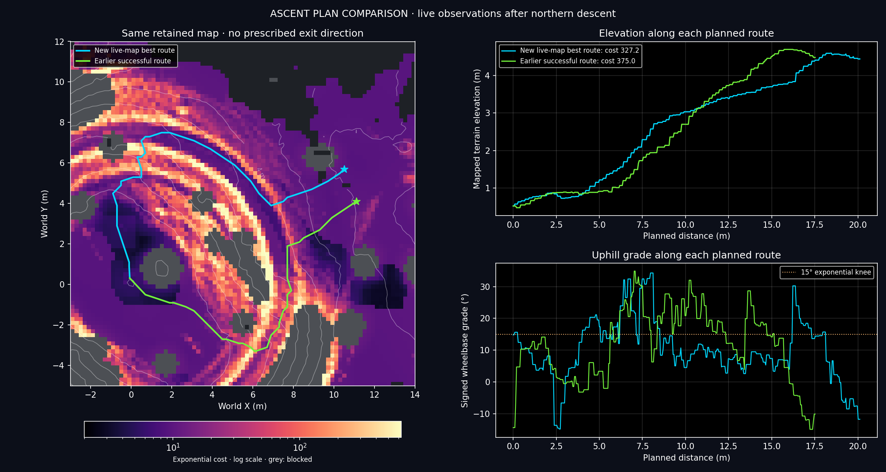
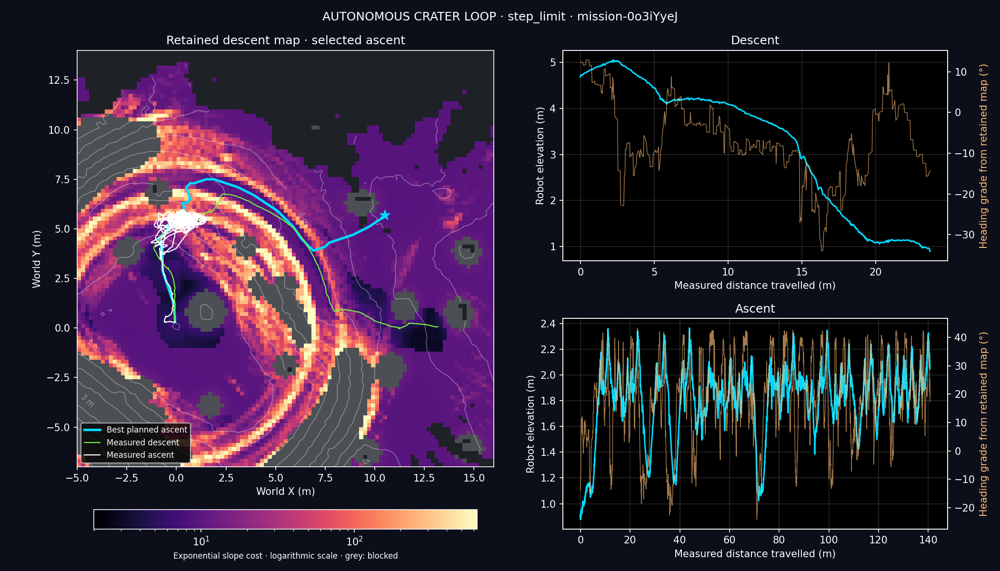

**Superseded by successful blue-route validation:** the user requested restoration
of the previously validated corridor. That full loop completed in **185.90 s**
with zero recoveries or intervention. See [the current report](crater_west_loop_2026-10-25.md).
The northern-route failure below remains preserved as historical evidence.

# Full crater loop and dashboard correction — 25 October 2026

Subsequent work: [authorized ascent tracking correction](crater_tracking_2026-10-25.md).
The full-budget failure below is the baseline before that correction.

## Changes

Descent inherited the generic checkpoint controller's **25° side-slope limit**.
That rejected routes selected by the exponential cost planner. Descent now uses
**40°** directional execution limits. The existing 35° terrain-map classification
is unchanged; this corrects the executor’s stricter 25° rejection without
changing which terrain the cost planner classifies as blocked.
The existing data-edge checkpoint margins and gentle backout planning remain;
40° is an execution ceiling, not a preferred route slope.

At the center, the original directional limits are restored before freezing
the exit-planning input. The retained map and its 35° classification are preserved. Ascent keeps
its existing planner objective and unguarded feedback executor. No compass
sector, historical route, terrain prior or manual checkpoint is prescribed.
Every observed, connected gentle exterior terminal competes under the accepted
exponential slope cost (15° knee, 6° scale).

The dashboard recursively nested Matplotlib colorbar locators whenever its
live logarithmic scale changed. Clearing the axes did not remove that locator
chain. It now creates one colorbar and updates its normalization; terrain/layer
switches hide or reuse it. The layout, magma colors and autonomous label remain.

## Validation

- **1,361 tests passed in 91.05 s** on the final execution-only revision.
- Regression test: 1,100 changing scale/layer frames reuse the same colorbar and
  locator, with periodic real canvas draws and no growing axes count.
- Descent execution test accepts a 32° cross slope previously rejected at 25°,
  then verifies restoring ascent limits without changing map masks or heights.
- **Actual TkAgg stress test:** 1,100 redraws in 67.27 s, zero callback errors,
  stable colorbar/locator identity.
- Full headless mission budget exhausted at **899.98 s**, result `step_limit`,
  `counts_as_mission: false`. Descent passed; ascent did not complete.
- The initial GUI integration smoke run started successfully with the dashboard
  and overlay; it was interrupted because viewport rendering was substantially
  slower than headless physics. It is not a full-mission result.

The full mission remains one command:

```bash
./crater_auto_nav.sh
```

The headless validation uses `./crater_auto_nav.sh --headless --no_dashboard`, with the
same physics, controller, sensors, live-map retention and 900 s mission budget.

The first full-run attempt (`descent40_full_v1`) also raised the map ceiling to
40°. That changed frontier selection and ended in HOLD at 37 s. The map-ceiling
change was removed; the final trial changes only directional execution to 40°.
Its [failed-trial audit](crater_full_loop_2026-10-25/map40_failed/audit.json)
correctly shows a source mismatch against the final revision.

## Physical result and route comparison

Run `outputs/crater_loop/mission-0o3iYyeJ` descends through the north corridor.
It confirmed the center at **99.60 s**, settled at **100.24 s**, and started
executing the new ascent at approximately **100.4 s**. No descent reverse was
required. The largest map slope under the robot during descent was 32.07°;
this is distinct from body tilt, which transiently reached 51.18°.

The selected ascent is **20.158 m**, cost **327.222**, to `(10.5, 5.7)`.
Planning took 0.231 wall seconds on the retained sensor map. This is the least
cost admissible terminal in the sampled directional graph, not a proof of
physical executability or a continuous-space global optimum.

An offline comparison placed the earlier successful blue route on this same
map, moving its first point to the current settled pose. Its cost is **375.048**.
The principal difference is rough-slope interaction cost: **127.520** on the
earlier route versus **83.805** on the new route. The earlier route is observed
and geometrically unblocked; lack of coverage is not the explanation for the
northern choice. Its old endpoint also fails the current map's existing gentle
settling-footprint check. No historical route was loaded into navigation.



[Comparison inputs and cost breakdown](crater_full_loop_2026-10-25/route_comparison.json).
The earlier route is green here to distinguish it from the newly selected cyan
route; the cost-map magma/log palette is unchanged.

Ascent did not clear its first steep section near `(0.5, 5.5)`. The trace
shows repeated TURN → DRIVE → TURN transitions within a single control tick:
the robot achieves a fixed turn heading, but its changed position makes the
nearby route target demand another turn immediately. Reverse/turn/push recovery
did not resolve the cycle. The unmodified ascent executor exhausted the full
900 s mission budget. The user subsequently authorized a tracking correction;
see the follow-up linked above. This baseline trial contains no tracking changes.

The final trace contains **134 immediate turn restarts**, 24 reverse attempts,
23 recovery turns and 22 pushes. Of the 799.6 s ascent phase, **571.36 s** were
normal turning and **66.32 s** normal driving; recovery consumed 160.96 s.
It rolled over briefly at 504.10–504.84 s (`up_z < 0`, minimum −0.810), then
returned upright. Final XY was `(1.007, 5.431)`, still inside the crater.
This is a physical failure, not merely an overcautious planning refusal.

No intervention, reset, policy switch, imported map or runtime source change
occurred. The 45,000-row trace is continuous at 20 ms; provenance matched all
runtime sources at completion, before the subsequent tracking revision.
Launcher exit status was 1, correctly rejecting an
incomplete mission.

- [Final audit](crater_full_loop_2026-10-25/execution40_full/audit.json),
  [summary](crater_full_loop_2026-10-25/execution40_full/summary.json),
  [mission stages and plan](crater_full_loop_2026-10-25/execution40_full/loop.json).
- [Events](crater_full_loop_2026-10-25/execution40_full/events.json),
  [10 Hz trace](crater_full_loop_2026-10-25/execution40_full/trace_10hz.csv),
  [source and policy hashes](crater_full_loop_2026-10-25/execution40_full/provenance.json).
- [Exact planning map](crater_full_loop_2026-10-25/execution40_full/ascent_input.npz),
  [selected trajectory](crater_full_loop_2026-10-25/execution40_full/exit_route.csv).



The dashboard screenshot is a TkAgg display stress fixture, not a recording
of this headless mission. Its actual 1,100-frame result is archived in
[tk_stress.json](crater_full_loop_2026-10-25/tk_stress.json); the accompanying
`tk_colorbar_stress.py` reproduces the test from the repository root with
a display available.
