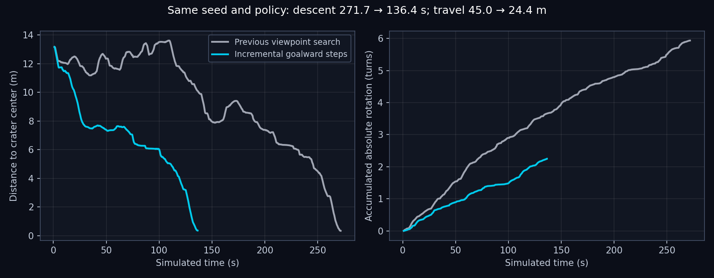

# Incremental, goalward descent — 24 October 2026

**Subsequent user-run failure:** [edge approach and unsuccessful recovery](crater_edge_failure_2026-10-24.md).
The successful descent below is one trajectory, not reliable edge/recovery
qualification. The later run reached an edge too quickly, delayed reversing,
released an unsuccessful retreat and slid downhill.

The user rejected the previous planner's slow back-and-forth search for better
viewpoints. Its 271.70 s descent reached the center but spent too much travel
and steering effort around the rim. This revision keeps the exponential slope
objective and shared reverse recovery while replacing that exploration policy.

## Behavior

- No unknown-area reward, visited-point novelty bonus, or fallback to viewpoints
  farther from the goal. An old sideways observation target is not retained.
- With no complete observed route to the center, choose a local step between
  0.55 and 2 m away. Require at least 0.25 m goal-distance reduction and at least
  0.5 m reduction per metre of direct travel. Reject routes longer than 2.5 m,
  longer than 1.5 times direct distance, or backing more than 0.1 m away from the
  goal. Rank progress against exponential terrain cost, excess travel and turn
  angle. These are planning preferences, not motion turning vetoes.
- Each frontier endpoint must support a straight 0.6 m observed backout along
  the final approach. Every touched cell in that retreat corridor must satisfy
  the body/data mask and wheelbase-scale terrain inclination ≤20°. The existing
  15° cost knee strongly prefers easier slopes. The 20° frontier threshold is a
  tunable planning limit, not a newly measured traction guarantee.
- Route reserve beyond the circular body, ordinary clearance and cell-square
  allowance is 0.10 m. Checkpoint reserve is 0.15 m up to 15°, increasing by
  0.02 m/degree above that. Missing measurements and plane extrapolation remain
  outside the evidence boundary. Smaller reserves allow closer approaches
  without placing the body in unknown terrain.
- Use a straight local segment when its checked exponential cost is within
  10% of the solved route, avoiding gratuitous grid bends. Near an incomplete
  route's checkpoint, fresh map revisions roll the short horizon forward.
  Intermediate arrival tolerance is 0.20 m; final-goal tolerance is unchanged.
- Missing usable goalward data causes rescanning/hold; it does not authorize
  an unseen crossing. Reverse remains progress-triggered at 0.4 → 0.7 → 1.0 m/s.
  Connected center routes still use the full exponential-cost planner.

The dashboard, logarithmic magma colors, ascent objective and launcher remain
unchanged. Run `./crater_auto_nav.sh` from the repository root.

## Validation

Focused tests cover goalward frontier selection, refusal of lateral-only
fallbacks, easy versus steep retreat corridors, stale sideways targets, and
advancing a checkpoint after new observations without stopping. The full suite
passed **1,351 tests in 83.68 s** with
`PYTEST_DISABLE_PLUGIN_AUTOLOAD=1 python -m pytest -q tests` in `env_isaacsim`.

Seed-42 run: `outputs/crater_loop/mission-gob3FAYa`, launched using
`./crater_auto_nav.sh --headless --no_dashboard --max_steps 15000`. The preceding
observation-reserve run, `mission-AHG7trWx`, supplies the comparison. Both use
the same spawn, terrain seed and trained policy; this is one trial per revision.

| Descent measurement | Previous viewpoint search | Incremental goalward steps |
| --- | ---: | ---: |
| Center confirmed | 271.70 s | **136.40 s** |
| Measured horizontal travel | 45.00 m | **24.42 m** |
| Accumulated absolute yaw | 37.30 rad | **14.13 rad** |
| Explicit reverse-recovery attempts | 2 | **0** |

This is **49.8% less descent time, 45.7% less travel and 62.1% less accumulated
turning**. Distance and yaw totals integrate consecutive 50 Hz measured poses
from 1 s through the last descent row. Negative velocity commands also occur
during braking/position holding; zero recovery attempts does not imply that
every individual command or body displacement was forward.

All five incomplete-route frontier checkpoints reduced goal distance by
0.84–1.87 m. New data advanced checkpoints while moving at 6.54, 20.20 and
22.68 s. A temporary data wait around 30 s resumed once a complete observed
center route became available. That complete route follows the northern
contour under the exponential cost objective. Existing slope rechecks still
caused some stops on known terrain; those remain outside this exploration
change.

The center settled at 137.04 s; ascent began at 137.20 s from the retained live
map. No operator driving, respawn or policy change occurred during descent.
The new 19.50 m ascent route targeted `(10.5, 5.7)` m. During ascent, reverse
recovery retreated 0.504 m at 203.64 s; another attempt ended with 0.374 m retreat
at 231.66 s. Both peaked at 0.7 m/s requested speed.

At 231.66 s, recovery-event logging raised `TypeError: Object of type int64 is
not JSON serializable`. The simulator ended without a final mission summary;
the launcher returned 1. **The full loop did not complete.** This leaves the
completed descent evidence intact; it does not qualify the northern ascent.

The failed-push counter summed NumPy booleans from recorded progress, producing
a NumPy integer. After the trial, it was changed to count matching entries with
Python integers. An event-serialization regression reproduced the exact error
before the fix; all **44 focused recovery/mission tests** passed afterward.
No descent code changed after this physical trial. The audit identifies the
single changed ascent source; the [patch](crater_incremental_descent_2026-10-24/post_trial_logging_fix.patch)
and [focused test output](crater_incremental_descent_2026-10-24/recovery_pytest.txt)
record the correction. A full physical loop was not rerun after this logging fix.

Evidence: [numeric comparison](crater_incremental_descent_2026-10-24/comparison.json),
[events](crater_incremental_descent_2026-10-24/events.json),
[10 Hz trace](crater_incremental_descent_2026-10-24/trace_10hz.csv),
[source provenance](crater_incremental_descent_2026-10-24/provenance.json),
[hash and continuity audit](crater_incremental_descent_2026-10-24/audit.json),
[test output](crater_incremental_descent_2026-10-24/pytest.txt),
[run termination record](crater_incremental_descent_2026-10-24/run_status.json).

The [descent dashboard](crater_incremental_descent_2026-10-24/descent_dashboard.png)
is reconstructed from the recorded telemetry and its adjacent saved map using
the actual renderer. It preserves the logarithmic magma palette and current
layout; it is not a GUI screenshot. Bulk telemetry and runtime source snapshots
remain in the local run directory.
