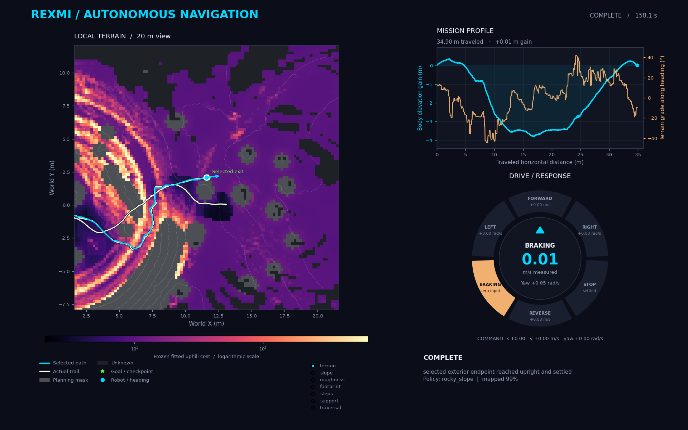

# Crater-loop validation — 24 October 2026

**Completed autonomous exterior → center → exterior mission: 158.12 simulated
seconds.** Run `./crater.sh` from the repository root to launch the continuous
mission with Isaac Sim, dashboard and overlay. [Operation and outputs](../crater_loop.md).

The default test uses seed 42, the existing rocky-slope checkpoint, exterior
spawn `(13, 0, 4.5, pi)`, live-only sensing, full map retention and autonomous
center-to-exit planning. The new exit is not the saved blue route. The robot,
policy and environment remain active throughout; there is no respawn between legs.

## Physical result

Run: `outputs/crater_loop/mission-jQyHzrxu`.

| Event | Measured result |
| --- | --- |
| Descent destination confirmed | 68.84 s, XY `(0.340, -0.221)` m |
| Settled center / frozen map | 69.46 s, XY `(0.351, -0.225)` m |
| Exit planning | 0.412 wall seconds; 15,712 known cells / 628.48 m² |
| Selected route | 16.387 m; fitted cost 294.722; target `(11.7, 2.1)` m |
| Ascent execution starts | 69.80 s |
| Exterior radius ≥11 m | 153.50 s |
| Exterior endpoint settled | 158.12 s; XYZ `(11.587, 2.087, 4.700)` m |
| Maximum ascent cross-track error | 0.458 m |
| Recovery | One descent steering reposition; zero ascent feedback recoveries |
| Intervention / policy switches / resets | None |
| Launcher exit | 0; `counts_as_mission: true`; two destinations completed |

The captured 50 Hz trace has 7,907 consecutive rows at 20 ms intervals.
The map comes exclusively from live sensor observations retained during this
mission. Map retention does not guarantee visibility of every crater cell;
planning used only connected observed terrain. Neither the manual trajectory
nor the previously accepted blue-route coordinates were loaded.

At 40.56 s, yaw-only steering had stopped making useful heading progress near
`(7.460, 0.719)`. The descent controller selected a short `+0.20 m/s, −0.35 rad/s`
maneuver, then replanned the checkpoint. It subsequently reached the center.
This is evidence for that recovery case, not every possible stall or backslide.

## Retained evidence

- [Unmodified run summary](crater_loop_2026-10-24/summary.json),
  [source/policy provenance](crater_loop_2026-10-24/provenance.json),
  [continuity and artifact hashes](crater_loop_2026-10-24/audit.json).
- [Mission/recovery events](crater_loop_2026-10-24/events.json),
  [10 Hz trace](crater_loop_2026-10-24/trace_10hz.csv).
- [Exit result](crater_loop_2026-10-24/exit_plan.json),
  [selected route](crater_loop_2026-10-24/exit_route.csv),
  [exact planning map](crater_loop_2026-10-24/planning_map.npz).

The copied planning map retains its original bytes/hash. Archived JSON keeps
the original run paths for provenance; the adjacent `planning_map.npz` is the
portable copy. Raw telemetry and runtime source snapshots remain in the local
run directory. The historical summary's `local_recovery_attempts: 0` counts
only its final ascent controller; the event trace records the descent recovery.
Current summaries expose separate descent and ascent counts and include both
in the mission recovery count.

The dashboard below is reconstructed from recorded telemetry and the frozen
planning map, using the actual dashboard renderer. Its grade history is
recomputed against that snapshot; it is not a screen recording of the
headless trial. The magma palette, cyan route, left local map, mission-distance
profile and circular command/response display are retained.

## Checks and development findings

CPU tests exercise actual-pose planning, no-route reporting without a historical
map fallback, stable center handoff, preservation of the live map object,
operator STOP during planning, drift-triggered replanning and a mission-wide
deadline. Additional checks cover steering-stall recovery, rejected route sets,
live-only configuration and descent recovery metadata.

- Full CPU suite: **1,333 passed**. After the final reporting/display changes,
  the 30 crater-loop/dashboard tests passed again. Shell syntax and `git diff
  --check` passed.
- GUI smoke: `./crater.sh --max_steps 200`, run
  `outputs/crater_loop/mission-F12eQRSn`. Overlay enabled with 6,586 tiles;
  no dashboard render exception. Stopped at the intentional 3.98 s step limit
  and returned exit 1, correctly reporting an incomplete mission.
- Initial development run `mission-R5vjhUFw` was interrupted to repair the
  live-plan constructor's inherited requirement for a simulator prior.
- `mission-loCqWL1v` exposed an old predictive turn-clearance refusal and was
  interrupted. The loop now bypasses that execution veto and predictive
  steep-edge repositioning, while keeping checkpoint route planning.
- `mission-MsacTh4W` exposed ineffective yaw-only steering and then an existing
  `StopIteration` at 117.94 s when all route alternatives were rejected. The
  route-label lookup now runs only for an actual selected route; measured turn
  stalls invoke existing repositioning maneuvers.

After the complete trial, only recovery-count reporting and live descent-map
contours changed in runtime files. Those changes were checked by focused tests
and the GUI smoke. The successful trial's source fingerprints remain intact.

This is one successful seed-42 simulation. Repeated runs, other seeds, terrain
variants, and hardware operation are not qualified by this result.
