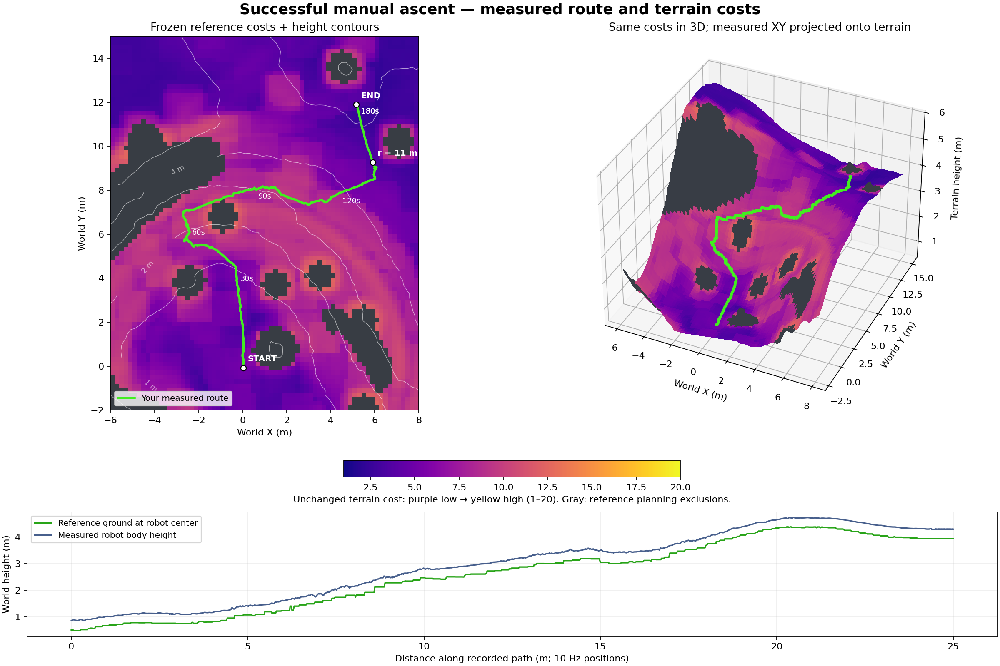
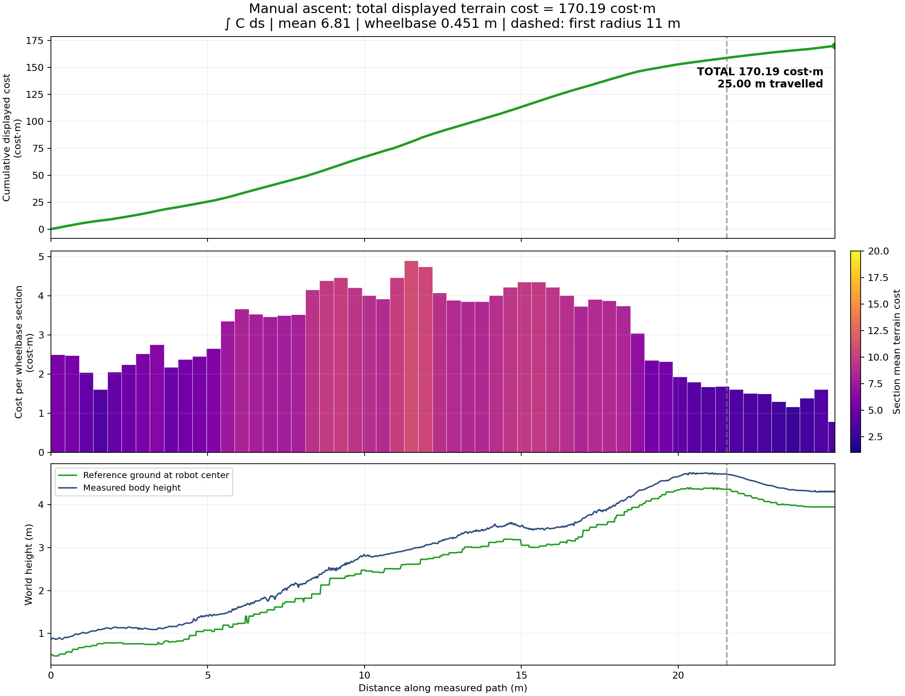
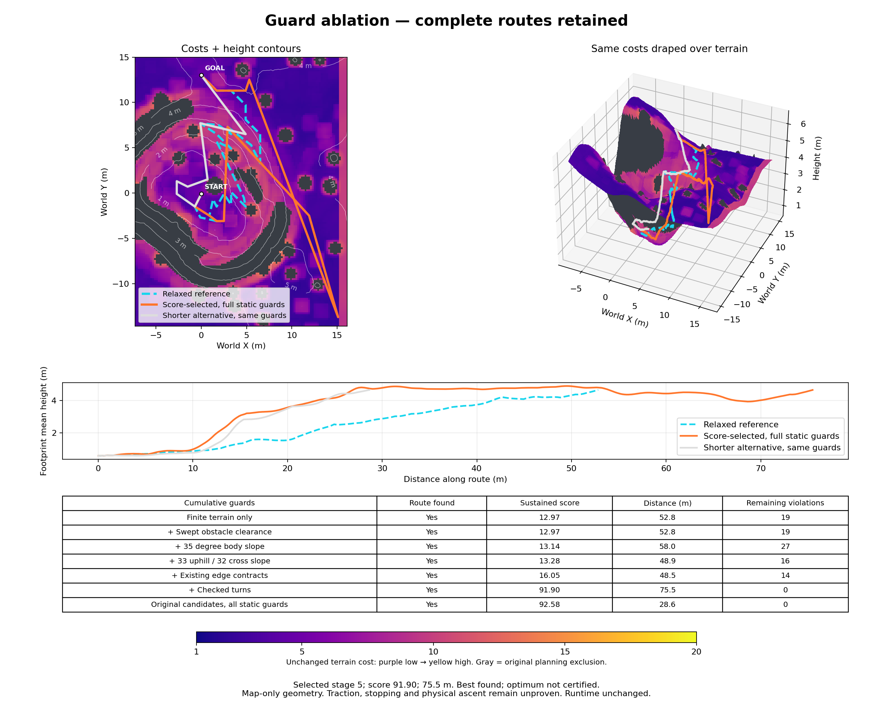
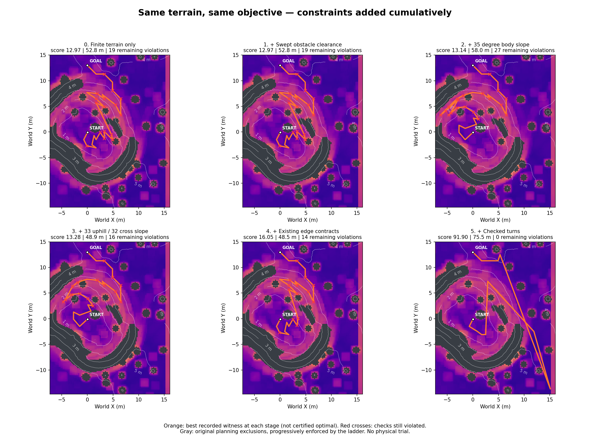
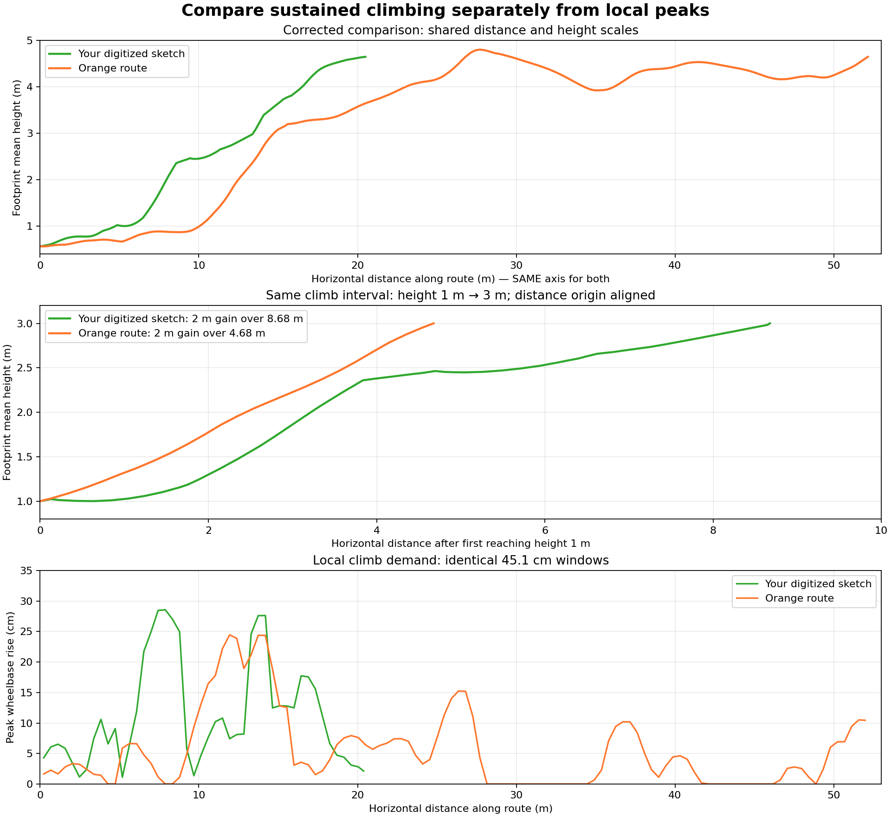

**Latest successful result, 25 October:** the user selected the previously validated blue western
ascent corridor. `./crater_auto_nav.sh` now loads its versioned route coordinates and
connects the measured center arrival, retaining the live descent map. Original
v2 turn/drive tracking is restored; northern-route tracking trials are retired.
The complete loop finished in **185.90 simulated seconds**, with zero recoveries,
manual interventions or policy switches; descent reached the center at **99.60 s**.
All 1,363 CPU tests pass. See [evidence](crater_west_loop_2026-10-25.md) and
[operation](../crater_loop.md).

**Earlier 25 October result:** [40° descent execution, dashboard fix and full-loop trial](crater_full_loop_2026-10-25.md). Descent reached the center at **99.60 s**, then planned a fresh ascent from the retained map. The unchanged ascent executor stalled in repeated turns/recovery and exhausted the **900 s** budget, including a brief rollover. **Full-loop completion failed.** All 1,361 tests pass; the dashboard passed 1,100 actual Tk redraws without callback errors. Subsequent northern-route tracking experiments were retired after the user requested restoration of the validated blue route.

**Earlier 25 October follow-up:** [simplified descent correction and validation](crater_descent_completion_2026-10-25.md). The complex experimental descent rewrite was retired at the user’s direction; that revision reached the center in 138.74 s unattended and 150.52 s with STOP/RESUME (seed 42). Those trials validated ascent handoff only.

# Rexmi crater navigation — handoff, 23 October 2026

**Latest status, 24 October:** [descent response corrections](crater_descent_response_2026-10-24.md)
pass 1,365 CPU tests; both final physical trials end in HOLD before the center.
Four retreats reached and held their return points, but recovery arrival
oscillation and frontier selection remain unresolved. Earlier successes below
belong to their recorded revisions.

**Subsequent full-loop result:** `./crater_auto_nav.sh` now runs autonomous exterior →
center → exterior navigation, retaining live descent observations and planning
a fresh exit at the center. Seed 42 completed in **158.12 simulated seconds**,
with one descent steering recovery and no intervention, reset or policy switch.
See [operation](../crater_loop.md) and [validation](crater_loop_2026-10-24.md).
The standalone-ascent and historical handoff below describe earlier milestones.

**Current follow-up:** [conservative descent and stronger reverse recovery](crater_descent_observation_reserve_2026-10-24.md).
Descent now prices steep downhill travel exponentially, reserves measured space
around checkpoints and escalates stalled reverse attempts to 1.0 m/s.
The 158.12 s result above belongs to the preceding revision.
The subsequent [incremental descent update](crater_incremental_descent_2026-10-24.md)
removes unknown-area viewpoint rewards and reduces easy-ground stand-off,
using short goalward steps with observed reverse corridors.

Updated 24 October 2026 with the successful **autonomous blue-path simulation
ascent**, the earlier human-driven baseline, fitted slope costs and execution evidence.

## Read this first

**Latest result: autonomous ascent completed at 102.30 simulated seconds.**
After the user explicitly removed all simulation motion vetoes, the robot
followed the fitted blue route, crossed radius 11 m at 85.06 s and settled at
`(11.403, 3.996, 4.734)` m. No manual intervention, policy change or stall-recovery
sequence was needed. The previous guarded and new unguarded runs have identical
poses and commands through 42.16 s; the new run continued past the former
predictive refusal. See [completion evidence and original-color map](../ascent_navigation.md#successful-autonomous-blue-path-ascent--24-october-2026).
This is one completed seed-42 simulation ascent. Recovery branches are implemented
but were not needed; generalization, repeatability and complete round trips remain
unproven by this run.

Planning context: the user accepted the exponential wheelbase-scale slope
fit and its blue/cyan southeast/east any-exit route, then authorized a simulation
of that exact path. See the [maintained route comparison and execution details](../ascent_navigation.md#reading-the-accepted-route-comparison),
including map, cost curve, elevation-distance and signed slope-distance panels.
Orange is the fitted western-ring route to the manual endpoint; green is the
successful manual trace; red is the rejected northeast corridor. This new blue
route is different from the earlier cyan corridor the user rejected.
The preceding guarded trial followed 7.22 m of the 17.25 m route with 0.211 m
maximum cross-track error, then stopped at 42.18 s on a predicted turn-footprint
35° terrain-boundary refusal. No exit or physical climb failure was recorded.
See [run results and trace](../ascent_navigation.md#blue-path-simulation-result--24-october-2026).

The historical handoff below predates the new successful autonomous ascent.
The user had completed a recorded manual floor-to-exterior ascent on 24 October.
At handoff time autonomous work had produced static comparisons, without a
successful ascent. The user was dissatisfied with prolonged experimentation, resource consumption,
unnecessary restrictions, sharp turns and routes that still contradict terrain
intuition. They requested this handoff to let another agent take over.

The manual baseline and its path-design rationale remain below. The
earlier map study showed complete routes under all tested static checks, but
their ranking and geometry are still poor. A custom score chooses
a 75.48 m route over a 28.64 m route with identical static guards for only 0.73%
lower modeled cost. Neither route is a demonstrated autonomous ascent.

**Do not mistake tests, reviewer ratings, map connectivity, or plots for physical
mission success. Do not replay the user's trajectory and call it autonomy.**

Repository: `/home/susan/rexmi_rl`. Recorded HEAD:
`c243b5b5fb51e5105aeaa06143009ec8a9d139ca`. This identifies local HEAD, not a newly
verified GitHub backup. The worktree contains extensive pre-existing modified
and untracked work; many navigation modules are untracked. Preserve it. Do not
reset/clean the repository. [Captured worktree status](crater_navigation_handoff_2026-10-23/worktree_status.txt).

## New manual ascent baseline — 24 October 2026

Read the [complete manual ascent report](manual_ascent_2026-10-24/report.md),
including the user's first-person path-design and driving account, before changing
navigation. The [maintained experience and design brief](manual_ascent_2026-10-24_experience.md)
is included in that report by the analysis generator. The human trace is evaluation
evidence; it must not become supplied waypoints or a timed command replay.

### Recorded outcome and integrity

| Item | Measured result |
| --- | --- |
| Capture | `logs/telemetry/manual-ascent-fr4H8xPa` |
| Environment | Seed 42 crater bowl, rocky-slope policy, manual teleop, reference-cost and live LiDAR overlays |
| Settled start XYZ | `(0.026, -0.071, 0.867)` m; initial spawn drop excluded |
| Exterior crossing | Radius ≥11 m at 139.48 simulated seconds, 128.98 s after first command |
| Final XYZ | `(5.168, 11.894, 4.297)` m; radius 12.97 m |
| Peak body height | 4.741 m; gain from settled start 3.874 m |
| Physics capture | 36,344 verified samples at 200 Hz |
| Command/pose capture | 9,086 complete steps at 50 Hz; 181.72 s recorded |
| Integrity | No gaps, resets or policy changes; completed pose and command logs agree |
| Shutdown | Requested SIGINT stopped simulation; no final close marker; 3 partial-step samples excluded, raw files unchanged |
| Inputs used | Forward up to 0.40 m/s, yaw ±0.35 rad/s, zero input; no reverse in this run |
| Largest measured zero-input climb | 33.76–52.52 s: +0.763 m body Z, 2.255 m net XY displacement |
| Other zero-input climbs | 54.72–68.86 s: +0.550 m; 113.34–121.46 s: +0.348 m |

Before the first exterior crossing, commands were forward for 27.66 s, turn-only
for 26.86 s and zero for 74.46 s. Zero commands kept the learned policy active.
There is enough telemetry to study command timing, posture, joint motion and
contact loading. The aggregate wheel-contact-count column is unavailable; the
individual foot forces are present. Torque/power are actuator estimates, raw
LiDAR frames were not saved, and exact per-wheel slip is not established.

Body height/tilt must not be confused with terrain elevation/slope. These are
observational intervals at different terrain/posture states, not a controlled
proof that zero input always outperforms forward input. This is a manual ascent,
not a calibrated success probability, autonomous qualification or round trip.

### Measured path and total displayed cost





- Full recorded path after settling: **170.19 cost·m over 25.00 m**, mean cost
  **6.81**. First exterior crossing: **158.99 cost·m over 21.54 m**.
- Definition: **∫ C(x,y) ds**, integrating the unchanged displayed cell costs
  exactly along the 10 Hz measured polyline, including cell boundaries and the
  final endpoint. Actual repositioning/drift counts; stationary time does not.
- Full 50 Hz sensitivity: **173.03 cost·m**, **+1.67%**. This quantifies sampling
  sensitivity; 10 Hz is not asserted to be a noise-free ground-truth path.
- Bars divide distance into nominal **0.451 m wheelbase** sections, with a shorter
  final section. Height profiles keep measured body height and reference ground
  height separate.
- This number is **not** the experimental sustained-climb score from the earlier
  table, physical energy, or success probability. No extra turn, history or
  exclusion-mask penalty is added. Do not compare unlike cost definitions.

The old map-study goal `(0,13)` and old autonomous goal `(13,0)` differ from this
manual endpoint. Future numerical comparisons must use matched start, endpoint,
map and metric. [Baseline metadata](manual_ascent_2026-10-24/baseline.json),
[measured baseline route](manual_ascent_2026-10-24/baseline_route.csv),
[cost definition and sensitivity](manual_ascent_2026-10-24/path_cost_summary.json),
[command intervals](manual_ascent_2026-10-24/command_segments.csv), and
[source/artifact hashes](manual_ascent_2026-10-24/artifact_manifest.json) are preserved.

### User logic to carry into planning and guardrails

1. **Gain height through dark, gentler terrain with a supported onward route.**
   Inspect the final connecting climb; do not accept a low-cost pocket enclosed
   by high costs or obstacles. Evaluate difficult wheelbase-scale and sustained
   climbing sections explicitly rather than averaging them away with easy travel.
2. **Use the elevated low-cost ring to find an exit opening.** The user expected
   to turn after roughly 2 m gain on this terrain. This is terrain-conditioned
   contour travel, not a fixed-height waypoint or a requirement for monotonic Z.
3. **Angle the last short climb diagonally where that improves the approach.**
   Check directional grade, cross slope, footprint and onward access together.
4. **Initiate motion, then let the policy continue productive zero-input climbing.**
   Do not re-launch or interrupt simply because a timer expires. Route/ground
   progress and repeated backslide matter more than momentary body-height noise.
5. **After roughly 5–10 s of failed progress, try a small heading correction
   toward gentler terrain.** This is the user's diagnostic range, not an already
   validated timeout change. Permit physically justified recovery turns on slopes;
   routine climbing should avoid unnecessary simultaneous turning. Commit to a
   correction and observe its effect instead of oscillating each tick.
6. **Keep protections tied to physical hazards.** Preserve STOP/takeover, drop,
   collision, tip and capability checks. A costly cell or planner rejection is not
   a failed physical attempt. Avoid exact-path vetoes that prohibit a useful
   diagonal correction. Forward/reverse remain available as the situation needs.

Behavioral target: **position → initiate climb → release while progressing →
adjust approach after measured failure → retry or reposition**. Approximately
2 m gain and 5–10 s patience are context from this demonstration, not constants
to copy indiscriminately. Do not treat one success as permission to remove all
physical protections or as a reason to hard-code the user's route.

Status: this update adds analysis and design requirements; autonomous runtime
behavior is unchanged. The next agent should audit conflicting costs/vetoes
against this evidence, make a bounded change, and obtain the existing controls
and practicality reviews before a new simulation. Preserve the raw capture.

Reproduce the offline report and figures:

```bash
/home/susan/miniconda3/envs/env_isaacsim/bin/python scripts/analyze_manual_ascent.py \
  logs/telemetry/manual-ascent-fr4H8xPa
```

## User intent and disappointment

The requested product is autonomous outside → crater center → outside navigation,
using the existing rocky-slope policy and the same command pipeline as teleop.
The user demonstrated manual traversal and expects the autonomous system to
exploit that capability, choose sensible terrain, and adapt instead of repeatedly
braking or refusing motion. Adaptive gait/crater access comes before thermal gait.

Recent direct user statements:

> “The paths are too sharp with high turns unnecessarily.”

> “There are also unnecessary turns and movement without any reason as well in the crater floor.”

> “Im trying to figure out if we’re doing something novel and the solution probably already exists.”

Their frustration is substantive: repeated weight changes and increasingly
complicated search machinery have not delivered the required traversal. Earlier
GUI trials also showed interrupted turns, excessive braking and failures around
apparently manageable boulders. Those historical physical complaints are not
revalidated by the latest map-only study.

The user's terrain preference is intelligible: gain useful altitude on low-cost
ground, traverse contours when useful, then climb the next favorable section,
while retaining a connected route to the exterior. Their sketch is comparison
evidence, **not a route template or planner input**. They explicitly allowed
32° cross-slope and argued the policy can climb near 33°. They want ordinary
climbs largely straight, but permit necessary recovery turns and heading changes
at useful local slope minima. High speed is for flat terrain, not slopes.

Other persistent requirements:

- Preserve policy weights, physics, observations, checkpoint behavior, STOP and
  manual takeover, and Isaac Sim LiDAR/cost overlays.
- Full-crater information is expected before ascent. A labeled simulator survey
  was explicitly authorized for development; it is not onboard perception.
- Forward **or reverse** as appropriate; avoid tick-to-tick command oscillation.
- Zero desired velocity keeps the learned policy active. Continue productive
  zero-command climbing; do not assume zero input always improves ascent.
- Navigation qualification uses ±0.40 m/s and a 900 simulated-second mission
  deadline. Preserve actual progress rather than repeatedly resetting patience.
- Be economical and practical. The latest budget clarification waived the weekly
  allowance concern “for now”; it did not ask for unlimited experimentation.
- Historical review workflow: executor → diagnosis agent → controls reviewer,
  with a separate practicality/resource reviewer and ≥8/10 before trials.
  These are agent assessments, not engineering certification.

## Earlier autonomous map study — 23 October 2026

One **frozen-map guard-ablation batch**, no Isaac Sim physics or robot commands.
Inputs are the exact archived planning map, not a newly rebuilt costmap.

| Item | Value |
| --- | --- |
| Snapshot | `outputs/remote_autonomy/reachable-height-objective/stable_capture/request-d55yep2q.npz` |
| Map provenance | Seed-42 crater-bowl development survey plus archived planning fields |
| Start | `(0.0202044, -0.0858835)` |
| Goal | **`(0, 13)`** |
| Inventory | 74 original candidates + 360 neutral grid anchors = 434 |
| Proposed directed connections | 8,908 |
| Connections with objective support | 8,354; 554 lacked extended height support |
| Candidate spacing | 1.6 m neutral grid, plus preserved original candidates |
| Total elapsed | 155.22 seconds |
| Final optimizer | 200,000 extensions; 14,161 labels; 9,931 expansions; zero improvements |
| Final optimizer status | Censored, complete candidate retained, **not optimal** |
| Verification | 223 focused/regression tests passed |
| Review | Controls 8.5/10; practicality 8.6/10; A2 EXACT100 |
| Runtime changes from ablation | None |

The map-study goal `(0,13)` differs from the earlier physical mission target
`(13,0)`. Do not silently equate these experiments. Frozen planning archives
also do not restore simulator state or controller dynamics.

### Earlier map-only plots

Colors are fixed: plasma terrain cost **1–20**, purple low → yellow high; gray
means the original planning exclusion mask, not proof of physical impossibility.
Contours show terrain height. These displayed cell costs do not by themselves
include the full directional/history-dependent route objective.



- Cyan dashed: relaxed reference candidate.
- Orange: score-selected candidate with all tested static guards.
- Light gray: shorter candidate with the same static guards.
- No line in this figure is a physically validated autonomous traversal.



Red crosses indicate outstanding check failures at that stage. Counts are
**violation records**, not distinct guardrail types. Multiple checks can reject
the same segment. Each stage retains the same candidate/connection universe;
the original-candidate-only comparison is separate.

| Cumulative constraint stage | Best recorded sustained score ↓ | Length | Outstanding violation records |
| --- | ---: | ---: | ---: |
| Finite objective data only | 12.9683 | 52.82 m | 19 |
| + Oriented obstacle clearance | 12.9683 | 52.82 m | 19 |
| + 35° body slope | 13.1415 | 58.00 m | 27 |
| + 33° uphill / 32° cross-slope | 13.2815 | 48.88 m | 16 |
| + Existing edge contracts | 16.0526 | 48.55 m | 14 |
| + Checked initial/join turns | 91.9015 | 75.48 m | 0 |
| Original candidates only, all static guards | 92.5818 | 28.64 m | 0 |

These are **best-of-generated-candidate comparisons**, not optimal costs for each
constraint set. A stricter stage can expose a better candidate to the cheap
generator; monotonic score changes are not guaranteed. Counts can rise because
the selected path changes. They are not probabilities.

The stage-4 candidate fails only turning checks: 13 locations are not minima
along their incoming/outgoing approaches; one lacks a supported route-relative
minimum. This proves those rules exclude that candidate, not that every similar
contour route is impossible. The original 19 records comprise 15 approach/departure
minimum failures, one unsupported minimum, one >35° body-slope failure, one 32.1°
cross-slope failure, and one overlapping geometry/exclusion failure.

## Current algorithms — not all A*

The last plot is **not ordinary A***:

1. Reverse breadth-first reachability establishes a complete connection.
2. Dijkstra searches generate minimum-additive-effort and minimum-length routes.
3. Candidates are rescored under the custom sustained-climb objective.
4. Only the strictest successful stage receives history-aware label search.
   It preserved the candidate when capped, but found no improvement.

Earlier implementations contain heading-state/weighted A*. Current experimental
routes are straight-line graphs through terrain-derived or grid anchors. Their
motion geometry does not intrinsically enforce smooth curvature. Replacing a
search's name with “A*” will not repair the objective or motion representation.

### Sustained-climb objective

Nominal wheelbase `L = 0.4505454148531053 m`, derived from the reference robot
stance. Actual articulated wheel spacing varies. Heights are supported footprint
means interpolated bilinearly; they are not simulated robot-body height.

For a climbing bout:

`B = integral(C * max(longitudinal wheelbase grade, 0)^2 ds)`

Route ranking is lexicographic:

`(sum of B^2 for completed bouts + unfinished B^2, total distance)`

A bout resets after about **1.00565 m** of continuous travel with absolute
longitudinal grade ≤15°. There is one reset per uninterrupted qualifying stretch;
waypoints alone do not reset it. This is a speculative moving-respite model, not
evidence of restored traction, a flat shelf, a safe turn or actual settling.

Consequences visible in code/results:

- **Distance only breaks exact score ties.** An arbitrarily small effort-score
  improvement can dominate a very large distance increase.
- Pure flat travel contributes zero uphill effort; gentle travel contributes
  little. Turns have no explicit effort/time penalty in this experiment.
- Sparse straight links produce corners; no simplification/smoothing is applied
  to these plotted outputs.
- Heading admissibility is mostly a hard yes/no test. It does not price steering
  effort, yaw reversals or command duration.
- Carrying bout history requires many labels per heading state. It adds search
  complexity without demonstrated physical predictive value.

The 75.48 m route adds **46.83 m** relative to the 28.64 m alternative, buying
only **0.73%** lower modeled score. The shorter route is a practical comparison
candidate, not a proven successful route or the current objective's winner.

## Static checks versus other limits

The plotted study includes the following requirements, some overlapping:

| Requirement | Implementation/meaning |
| --- | --- |
| Finite observed data | Cost and extended wheelbase/footprint-height support; data prerequisite even in relaxed stage |
| Swept obstacle clearance | No mapped hazard beneath the oriented moving rectangle |
| Overall terrain boundary | ≤35° beneath oriented footprint |
| Directional uphill boundary | ≤33° along travel |
| Cross-slope boundary | ≤32° across travel |
| Older circular envelope | Inflated center clearance and supported circular body footprint; overlaps rectangular checks |
| Failure evidence | Avoid mission no-go patches and excluded approach directions |
| Observation support | Fresh near-field corridor observations; configured retained static-survey support for physical sweeps |
| Turn support | Supported ground; conditional drift reserve near steep boundaries |
| Turn location | Gentle terrain or eligible local slope minimum; route-conditioned minimum compares approach/departure and requires ≥2° prominence |
| Steeper admitted rotation | Swept rotation obstacle/inclination checks and cross-slope limit through requested yaw change |

Waypoint selection also used to prefilter by stage eligibility, blocked/support
masks, endpoint height range and separation. The neutral anchors in the ablation
relax that hidden sampling restriction. Finite sampled candidates still limit
coverage; neither study is a continuous-space optimum.

Runtime STOP/manual, velocity, tip/posture, tracking and stopping protections are
separate. **They were not exercised by this map experiment.** The 200,000-extension
cap and 900 wall-second study cap are computation limits, not physical guards or
weekly account usage. The runtime mission's 900-second deadline is simulated time.

## Runtime and code boundaries

| File | Role/current state |
| --- | --- |
| `source/rexmi_rl/nav/remote_control.py` | Persistent teleop-style command controller; baseline remote v22 default, experimental objective options |
| `source/rexmi_rl/nav/sustained_climb.py` | Experimental v27 objective and bounded search; **runtime search still returns no route on exhaustion** |
| `source/rexmi_rl/nav/guard_ablation.py` | New offline-only staged analysis; candidate-preserving search is here, not promoted into runtime |
| `source/rexmi_rl/nav/stage_graph.py` | Original candidate inventory and straight-link graph |
| `source/rexmi_rl/nav/turn_staging.py` | Gentle/local-minimum turn admission |
| `source/rexmi_rl/nav/wheelbase_demand.py` | Wheelbase geometry and preceding fourth-power effort objective |
| `source/rexmi_rl/nav/climb_burden.py` | Supported height field and earlier positive-elevation cost |
| `source/rexmi_rl/nav/ascent_first.py` | Heading transitions and an earlier gentle-goal-suffix experiment |
| `source/rexmi_rl/nav/observed_map.py`, `swept_footprint.py`, `remote_routes.py` | Geometry, observation, exclusion and physical-envelope contracts |
| `scripts/analyze_guard_ladder.py` | Reproducible frozen-map batch; preserves metadata and candidates before optional work |
| `scripts/plot_guard_ladder.py` | Rendering only; reads saved results |
| `tests/test_guard_ablation.py` | Nesting, timeout/candidate survival, history, heading and inventory regressions |

**Launch mismatch to notice:** `scripts/launch_round_trip_gui.sh` currently selects
`--ascent_architecture behavior_tree`, not `remote`. The experimental route-objective
flag requires `--ascent_architecture remote`. `scripts/navigate.py` defaults its
architecture to behavior_tree and route objective to baseline. The offline
ablation is not a newly installed GUI navigation algorithm. Inspect the actual
launch flags before interpreting a future trial.

## Earlier evidence worth retaining

### Manual traversal and zero-command behavior

Read [teleop evidence](teleop_navigation_demo.md) before changing execution.
Raw sources: `logs/telemetry/crater-demo-20260923-222151/`, its sibling CSV, and
`logs/telemetry/crater-demo-repeat-20260923-225750/` with its sibling CSV.

The documented first demonstration retained 151.32 simulated seconds with no
recorded reset/policy change. It passed within 1.029 m of the center and exited
north near `(1.974,12.125)`. This supports traversal feasibility with the unchanged
policy, not completion of the exact autonomous center/`(13,0)` destinations.

After release in one ascent interval, zero requested velocity still produced
0.651 m horizontal advancement and 0.279 m height gain over 4.42 seconds. The
preceding powered interval gained more. Another zero-command interval lost a
little height. Zero input is active policy execution; wheelspin as the causal
explanation is plausible but not established.

### User sketch versus earlier orange route



An earlier chart used different horizontal-axis spans, confusing comparison.
The corrected shared-axis audit found the digitized sketch gained footprint-mean
height 1→3 m over **8.68 m** (~13° mean grade), versus **4.68 m** (~23°) for the
then-orange route. The sketch also has sharper short local peaks. That distinction
motivated sustained-climb scoring; it did not validate the new score or the sketch's
turns. Data: `outputs/remote_autonomy/wheelbase-section-comparison/`.

### Previous budget failure

`outputs/remote_autonomy/sustained-climb/`: the first map call failed while exporting
a NumPy boolean; its outcome was not preserved. A reporting repair and identical
replay reached 200,000 extensions in 41.89 seconds and returned no route. However,
the fully guarded graph already had a start-to-goal heading connection. It was
an optimization/reporting failure, not proof that no waypoint/route existed.
The offline ablation now retains complete candidates; the runtime fix is pending.

Other prior experiments remain in `outputs/remote_autonomy/` and are summarized
in [navigation development notes](../navigation_turns_and_routes.md). Do not
infer the outcome of historical “trial 10” or call a replay autonomous without
checking its actual command-generation and mission logs.

## Reproduction and artifacts

This handoff copies the plots/status so later plotting cannot overwrite them.
[Compact numerical results and routes](crater_navigation_handoff_2026-10-23/results_compact.json),
[status](crater_navigation_handoff_2026-10-23/status.json),
[artifact hashes](crater_navigation_handoff_2026-10-23/artifact_manifest.json).
Full result: `outputs/remote_autonomy/guard-ablation/result.json` (~7.8 MB), with
per-route metrics, violations and implementation hashes; `run.log` records stages.

Survey: `outputs/ascent_full_survey/trial01/run.prior.npz`;
SHA256 `30a170c590a8c61eae4fb6193905971ac6459ddf0af05d009cce3ce8b188edd4`.
Policy: `logs/rsl_rl/go2w_velocity_rocky_slope/2026-06-30_09-31-48/model_13994.pt`.
Neither was modified by the latest study.

Run the focused verification from the repository root:

```bash
PYTEST_DISABLE_PLUGIN_AUTOLOAD=1 /home/susan/miniconda3/envs/env_isaacsim/bin/python -m pytest -q \
  tests/test_guard_ablation.py tests/test_sustained_climb.py \
  tests/test_wheelbase_demand.py tests/test_climb_burden.py \
  tests/test_ascent_first.py tests/test_ascent_first_integration.py \
  tests/test_stage_graph.py tests/test_stable_candidates.py \
  tests/test_success_selection.py tests/test_remote_control.py
```

Reproduce the map study only if useful; use a new output directory:

```bash
trial_dir="$(mktemp -d "$PWD/outputs/remote_autonomy/guard-study-XXXXXXXX")"
/home/susan/miniconda3/envs/env_isaacsim/bin/python scripts/analyze_guard_ladder.py --output "$trial_dir"
/home/susan/miniconda3/envs/env_isaacsim/bin/python scripts/plot_guard_ladder.py "$trial_dir"
```

No simulator was launched for the original 23 October map-only handoff. The
24 October manual capture is documented above. No current autonomous GUI command is
certified to complete the mission. Avoid unset `$RUN` variables: a historical
launch expanded its log destination to `/run.events.jsonl` and failed permissions.

## Suggested direction — not implemented or proven

The last recommendation was to benchmark an established heading-aware A*/state-
lattice approach with robot-appropriate motion primitives, additive travel/terrain/
turn costs, and checked route simplification. Keep the crater perception and
policy-specific execution. Treat this as a proposed simplification, not a proven
replacement or a requirement to import a large new stack.

- [Nav2 Smac planners](https://github.com/ros-navigation/navigation2/blob/main/nav2_smac_planner/README.md)
  provide A*, Hybrid-A* and configurable state-lattice machinery. A car-only
  turning model should not be imposed on this robot without justification.
- [OMPL path simplification](https://ompl.kavrakilab.org/PathSimplifier_8cpp_source.html)
  provides shortcutting/smoothing with validity checks. Smoothing must recheck
  slopes and swept footprint; collision-free geometry alone is insufficient.

The next agent should independently reassess the objective and motion model,
not inherit the custom sustained-bout score as settled truth. The immediate
engineering questions are whether distance/turn effort are meaningfully priced,
whether turn rules reflect actual capability, and whether the resulting route
can be executed through the existing teleop-command pipeline. The final measure
is actual autonomous mission completion, not a lower plotted score.
