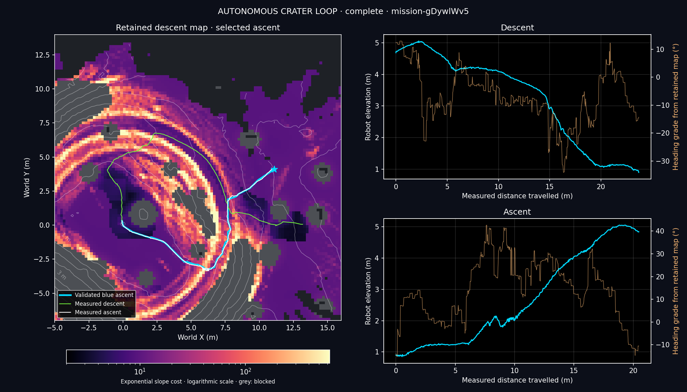

# Validated blue corridor restored — 25 October 2026

The user requested the previously successful western blue ascent corridor.
The earlier loop instead searched for a fresh cheapest any-exit route on its
new descent map. Keeping the fitted weights did not preserve the corridor:
that map ranked the northern route lower, and the original blue endpoint did
not pass the fresh planner's gentle-terminal check. Those are planning-selection
differences, not proof that the validated route stopped working.

## Active change

`./crater_auto_nav.sh` supplies `source/rexmi_rl/nav/routes/validated_west_seed42.json`.
All 27 coordinates exactly match `routes.any_exit` in the successful
`blue-path-unguarded-20261024-01/run.path-result.json` and the original
`slope-fit-20261024-04/result.json`. A straight connection is prepended from
the measured center arrival to the original first waypoint; no other
waypoint or endpoint changes. The route is versioned in the repository, so
launching does not depend on retained bulk telemetry or the old map file.
Task, seed, crater origin and radius are checked before simulation.

The retained descent map is still the source of live sensing, displayed costs
and recovery terrain preferences. Its frozen snapshot and hash are archived.
There is no new global exit search or gentle-terminal test in validated-route
mode. The accepted exponential weights are unchanged. No ascent slope or
turn-clearance veto is introduced.

The abandoned northern-route tracker versions v3–v5 have been removed. Normal
ascent tracking uses the original v2 0.35 m target and discrete turn/drive
behavior. The pre-existing progress-stall detector and requested reverse speed
escalation remain; this is not a byte-identical restoration of every October 24
recovery implementation. The original successful run needed no recovery.
Descent retains its 40° directional execution setting and latest measured-data
checkpoint selection. Dashboard layout, magma/log colors and the colorbar
recursion correction are unchanged.

## Validation

- 44 focused tests passed.
- Full CPU suite: **1,363 passed in 90.65 s**.
- Tests preserve every original waypoint and endpoint, attach the actual pose,
  retain the live map, prohibit fresh global search/terminal veto in this mode,
  and reject a different terrain seed before simulation.
- Continuous headless Isaac Sim mission `mission-gDywlWv5`: **complete at
  185.90 simulated seconds**; launcher exit code 0, `counts_as_mission=true`.
- Center confirmed at **99.60 s**, settled at **100.24 s**; ascent began at
  **100.40 s** and completed in **85.50 s**.
- Final measured pose: **(11.066, 4.150, 4.829) m**, upright and settled.
- **Zero** descent or ascent recoveries, manual interventions, policy switches,
  environment resets or teleports. Continuous 20 ms timestamps throughout.
- Actual connector: **0.397813 m**. All original blue waypoints are unchanged.
  Descent poses and commands match the failed northern-route baseline exactly.
- Ascent minimum `up_z=0.663`; no inversion. Its original tracker still recorded
  16 immediate turn restarts, but completed without recovery. This result does
  not claim that the discrete tracker is universally free of that behavior.
- Runtime source hashes match the archived provenance. No terrain prior loaded.

This establishes one successful continuous seed-42 simulation for this revision;
it does not establish success on other terrain seeds or hardware.

The plot keeps the accepted magma/log cost field and grey obstacles. Cyan is
the preserved blue plan, green measured descent, and white measured ascent.
Elevation and signed heading grade share distance axes on the right; grade is
computed from the frozen retained map, not a direct traction measurement.

[Audit](crater_full_loop_2026-10-25/west_blue_success/audit.json),
[mission summary](crater_full_loop_2026-10-25/west_blue_success/summary.json),
[route and connector](crater_full_loop_2026-10-25/west_blue_success/exit_plan.json),
[10 Hz trajectory](crater_full_loop_2026-10-25/west_blue_success/trace_10hz.csv),
[CPU tests](crater_full_loop_2026-10-25/west_blue_success/tests.txt).
The original 50 Hz telemetry and full runtime source archive remain local under
`outputs/crater_loop/mission-gDywlWv5/`.

The retired tracking trials and failure evidence remain in
[their report](crater_tracking_2026-10-25.md).
