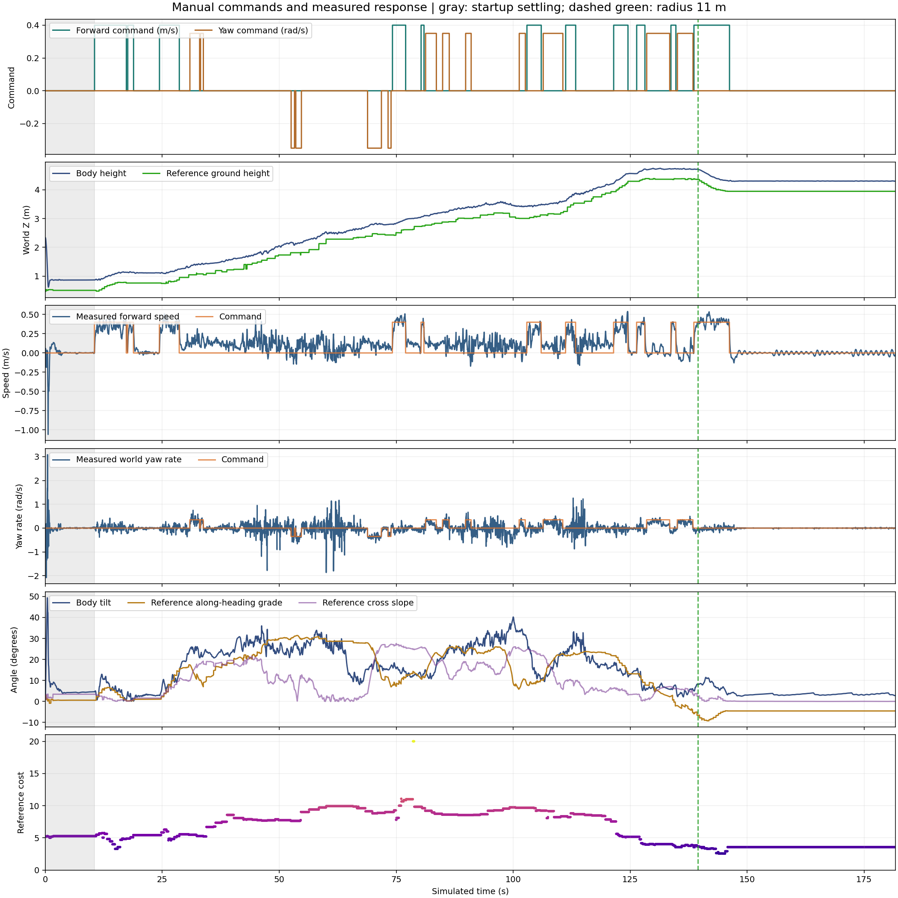
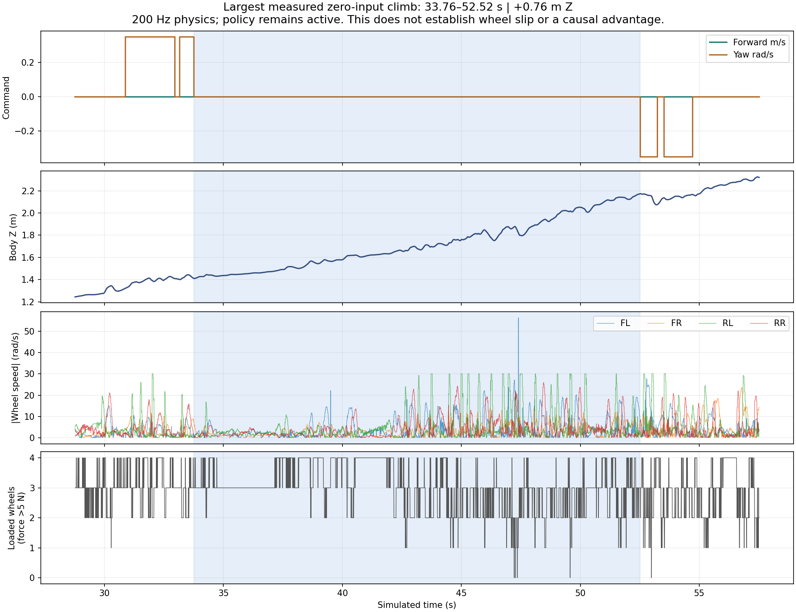

# Recorded manual ascent: manual-ascent-fr4H8xPa

- Exterior reached at 139.48 simulated seconds; 128.98 seconds after first command.
- Final XY: (5.168, 11.894) m; radius 12.97 m.
- Settled body height 0.867 m → peak 4.741 m (3.874 m gain).
- 36,344 verified physics samples at 200 Hz; 9,086 complete control steps at 50 Hz.
- No gaps, resets or policy switches; all completed pose/command logs agree.
- Shutdown has no final close marker; 3 partial-step samples excluded. Raw files unchanged.
- Automatic wheel-contact count column unavailable; individual foot forces are recorded and used instead.

## Total displayed path cost

**170.19 cost·m** over **25.00 m**; distance-weighted mean **6.81**.

Definition: ∫ C(x,y) ds on the frozen displayed map, integrating every cell crossing along the 10 Hz measured XY polyline. Starts immediately before the first command and ends at the last complete sample. Initial settling is excluded; actual drift and repositioning count, stationary time does not. Bar sections use the nominal 0.451 m wheelbase; the final section is shorter.

To the first 11 m exterior-radius crossing: **158.99 cost·m** over **21.54 m**. At full 50 Hz, total is 173.03 cost·m (+1.67% sampling difference).

This is the integral of the visible terrain costs, not the experimental sustained-climb planner score, energy, or success probability. No extra directional, turn, history or mask penalty is added. Compare machine and human paths using the same map, endpoints and metric.

[Cost summary](path_cost_summary.json) · [Cell-crossing profile](path_cost_profile.csv) · [Wheelbase sections](wheelbase_cost_sections.csv)

## Plots

## Measured zero-input intervals

- 33.76–52.52s: +0.763 m body-height change, 2.255 m net XY displacement.
- 54.72–68.86s: +0.550 m body-height change, 1.052 m net XY displacement.
- 113.34–121.46s: +0.348 m body-height change, 0.867 m net XY displacement.
- 86.32–89.82s: +0.102 m body-height change, 0.444 m net XY displacement.
- 77.00–80.30s: +0.085 m body-height change, 0.391 m net XY displacement.

## Interpretation limits

- Single human-driven ascent, not autonomous success or calibrated success probability.
- Initial spawn drop/settling excluded from ascent gain; all raw data preserved.
- Cost and terrain values are frozen reference-map estimates, not traction measurements.
- Contact loading is force magnitude >5 N; exact slip requires contact kinematics and friction data.
- Wheel torque/power are actuator-model estimates. Raw LiDAR frames were not recorded.
- Zero-input versus powered intervals have different terrain/posture; not a causal comparison.

For a matched autonomous comparison, use this measured settled start and actual exit. The recorded trace remains evaluation evidence, not an autonomous route input.

## User experience and route-selection logic

The following is the user's account of the successful 24 October manual ascent,
lightly edited for readability. It records intent; measured outcomes are in the
report above. It supersedes interpreting the earlier green sketch as the desired
route itself.

### Path design — user's account

> I knew climbing was going to be hard. I looked for the darkest sections of the
> costmap that offered the most elevation gain. I made sure that reaching those
> sections would leave a path to the exterior, rather than a dead end surrounded
> by massive costs and terrain to avoid.
>
> After gaining about 2 m of elevation, I needed to turn and use a small ring of
> lower-cost terrain to find an opening to the exterior. I followed that ring,
> then tried to get out. That left only a small section with a large elevation
> gain. Angling the robot correctly allowed a gentler diagonal approach through
> that section.

### Driving experience — user's account

> I let the robot do its thing. I commanded forward to start the climb, then
> stopped sending commands once it was climbing. I would intervene after perhaps
> 5–10 seconds of failed climbing, turning slightly toward darker patches to try
> a gentler diagonal slope. If the robot climbed a little and then slipped back,
> I tried turning: it already knew how to move forward.

“No command” here means zero commanded forward and yaw velocity while the learned
policy continues running. The 5–10 seconds describes **failed net progress**, not
a deadline for stopping a productive climb. The approximately 2 m gain describes
this route; it is not a universal altitude checkpoint.

### What the recording supports

- First exterior-radius crossing occurred 128.98 s after the first command,
  with no reset or policy change. Final position was `(5.168, 11.894)` m.
- Net body-height gain to the peak was 3.874 m from the settled start. Body
  height is distinct from ground elevation and body tilt from terrain slope.
- Zero-input intervals at 33.76–52.52 s, 54.72–68.86 s and 113.34–121.46 s gained
  0.763 m, 0.550 m and 0.348 m of body height, respectively.
- From first command to the exterior crossing, the input was forward for 27.66 s,
  turn-only for 26.86 s and zero for 74.46 s. No reverse command was used in this
  capture; it does not establish that reversing is unnecessary elsewhere.
- The measured route climbs the western corridor, traverses the elevated ring,
  then climbs toward the northeastern exterior. It is a useful executable
  baseline against which to judge route geometry and command persistence.
- Different commands occurred at different terrain and posture states. This
  demonstrates productive zero-input climbing, not that zero input is always
  better than forward, or that a wheel-speed spike proves loss of traction.

### Planning and guardrail design brief

Status: requirements derived from this demonstration. This reporting update does
not modify or validate the autonomous planner or controller.

| Decision | Required behavior | Check against this baseline |
| --- | --- | --- |
| Select an ascent corridor | Prefer useful terrain-height gain through low-cost, gentler sections. Evaluate local wheelbase-scale climbing demand and sustained exposure; a short difficult climb must not be hidden by long easy travel. | Show height gain, local grade and cost by section alongside the complete route. Avoid rewarding raw upward slope or adding a negative elevation bonus that creates search cycles. |
| Check onward access | Before committing to an elevated checkpoint, retain a feasible continuation to an exterior opening, including the eventual connecting climb. Test the complete connection, not merely proximity of two search fronts. | Demonstrate where the onward path crosses the rim; reject attractive pockets with no supported continuation. Connectivity remains a geometric prediction, not a guarantee of traction. |
| Use the elevated ring | Allow contour travel with little immediate height gain when it leads to a better exit climb. Select natural changes in terrain or approach as checkpoints. | Do not require monotonically increasing height, a heading directly toward the final goal, or a hard-coded turn after 2 m of gain. |
| Shape the final climb | Evaluate gentle diagonals using directional grade, cross slope, clearance and onward connection. Compare the hard climb sections explicitly. | A diagonal is useful only when it improves the complete approach; preserve footprint and established capability checks. |
| Execute productive climbing | Use the teleop command interface: position, initiate forward movement, release on observed response, and continue zero input while net uphill/route progress persists. | Do not brake, re-launch or replan simply because zero input has lasted several seconds. Measure ground/route advancement as well as noisy body Z. |
| Detect a failed attempt | Observe net progress and repeated gain-then-backslide over a bounded window. Use the user's 5–10 s as an initial diagnostic range to validate, not a new fixed timer. | Productive slow climbs renew patience; changing commands does not. Preserve the existing mission deadline and recovery accounting until changes are explicitly tested. |
| Adapt heading | When stalled or slipping, allow a committed small left/right correction toward a supported gentler approach, including on a slope when physically justified. Reassess the response before another correction. | Separate routine climb turns from necessary recovery turns. Avoid a blanket slope-turn veto, tick-to-tick oscillation, or exact-path tracking that forbids useful diagonal motion. |
| Keep physical protections meaningful | Preserve STOP/manual takeover, collision, drop and tip protections, existing capability limits and slope speed ceilings. Treat costs as ranking information. | A costly cell or planning rejection is not a physical failure. Do not infer universal turn permission from this one success or treat a contour as a flat turning platform. |
| Compare fairly | Generate routes independently from the same map and matched endpoints. Use the recorded route and command response only for evaluation and behavioral evidence. | No supplied human waypoints or timed command replay in an autonomous success claim. Compare completion, hard-section demand, progress, recovery and travel cost together. |

The practical behavioral sequence is **position → initiate climb → release while
progress continues → small approach correction after measured failure → retry or
reposition**. Direction and corrections depend on current observations; the
recorded button timings are evidence, not an execution script.

Next implementation should identify which current objective terms or vetoes
contradict these requirements, change the smallest responsible component, and
review a bounded test before another physical trial. A single successful manual
run is a baseline, not a calibrated probability model or autonomous qualification.
